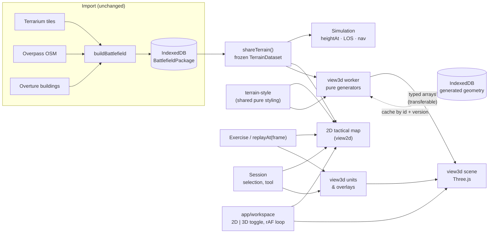

# 3D Terrain and OSM Rendering: Architecture Research

- Status: Research and recommendation, awaiting review. Nothing here is implemented.
- Date: 2026-10-11
- Scope: an interactive Three.js 3D battlefield view added alongside the 2D tactical map, built from
  the geographic data Ambush! already has.

Evidence conventions used throughout:

- **Verified**: seen in source code, a licence file or the npm registry (repositories were cloned and
  read; links are pinned to the commit that was read).
- **Assumed**: inferred, estimated or from general knowledge, not checked here.
- **Recommendation**: a judgement.

External repositories were read at these commits:

- terranian `0598790`
- osm_3d_model `85e9de0`
- Three-geo-play `961fe79`
- three-geo `5d7adf6`
- streets-gl `2412c8e`
- OSM2World (tordanik) `8ec26a9`
- maplibre-gl-js `6d26435`
- maplibre-gl-three `5e769e4`
- @dvt3d/maplibre-three-plugin `fc3b0e9`

Ambush! itself was read at `4135b64`.

Limitations:

- `https://github.com/OSM2World/OSM2World` asked for credentials, so it was not accessible. The
  canonical public repository, `https://github.com/tordanik/OSM2World`, was read instead.
- The GitHub API (stars, issues) was not available to this investigation. Activity is judged from
  git history and npm.
- No candidate was run in a browser, so their performance figures are estimates.

---

## A. Executive summary

**Recommendation: Architecture B, a modular Three.js implementation inside the existing `view3d`
layer.** Its geometry generators are written for Ambush!: pure, running in workers, and fed directly
from the shared `TerrainDataset`. They use a small set of focused libraries and port a few MIT
algorithms with attribution. Generated geometry may be cached (a hybrid with Architecture C), but it
is always generated from Ambush!'s own data.

The deciding factor is **shared geographic truth**:

- **The authoritative surface.** It is `heightAt` on the simulation heightfield, a triangulated 10 m
  grid with a fixed SW–NE diagonal (`src/sim/terrain.ts:118`, `terrainTriangleIndices` at `:151`).
  ADR 0006 and ADR 0008 already require that "the 3D view must build its terrain mesh from
  `terrainTriangleIndices`".
- **Units.** They stand at `position.z = heightAt(x, y)`. Line of sight puts building roofs at the
  lowest footprint corner plus `heightMeters`, and the vegetation canopy at `canopyHeightMeters`
  above the local ground.
- **Why the candidates fail this.** None of them can render _that_ surface:
  - three-geo, Terranian, Streets GL and MapLibre fetch their own elevation from Mapbox, Esri or
    zoom-dependent tiles.
  - OSM2World uses SRTM on a 30 m grid.
  - osm_3d_model clips peaks to percentiles.
  - Three-geo-play has no terrain at all.
- **Consequence.** Units would float or sink, and what a player sees would disagree with what the
  simulation computes.

**No candidate is a usable foundation:**

| Candidate      | Why it is not a foundation                                        |
| -------------- | ----------------------------------------------------------------- |
| Terranian      | Unlicensed, so legally not reusable                               |
| osm_3d_model   | A 10,000-line global-state viewer behind a QGIS plugin            |
| Three-geo-play | MVT-by-URL on a flat plane                                        |
| three-geo      | Mapbox-only and broken on current Three.js                        |
| Streets GL     | Its own WebGL2 engine, Esri heights, assets with unclear licences |
| OSM2World      | Java, SRTM, 30 m terrain                                          |
| MapLibre       | Zoom-dependent terrain and Web Mercator                           |

**Several have excellent, MIT-licensed algorithms worth porting.** The most valuable is Streets
GL's technique of clipping road and land-cover geometry to the terrain's own triangles and sampling
height with the same triangle split. With Ambush!'s `terrainTriangleIndices` this makes draped
features sit _exactly_ on the simulated ground, with no floating and no z-fighting.

**Recommended dependencies:**

- `three` (r186, MIT), with its bundled addons: CSM, Sky, GTAO, Line2, BatchedMesh,
  BufferGeometryUtils.
- `three-mesh-bvh` (MIT)
- `earcut` (ISC)
- `@three.ez/instanced-mesh` (MIT)
- `@dgreenheck/ez-tree` (MIT, run once to bake tree meshes)

**First milestone:** a 2D/3D toggle in the workspace that shows the battlefield terrain as a single
chunked mesh built from `terrainTriangleIndices`, with:

- the existing hypsometric and hillshade colouring as vertex colours or a texture;
- daylight, fog and orbit controls;
- the soldiers as simple markers at their simulated positions, live and in replay;
- verified height agreement between rendered ground and `heightAt`.

---

## B. Existing architecture analysis

### B.1 How geographic data flows today (verified)

| Concern         | Where                                                         | What it does                                                                                                                                                                                                                                                        |
| --------------- | ------------------------------------------------------------- | ------------------------------------------------------------------------------------------------------------------------------------------------------------------------------------------------------------------------------------------------------------------- |
| Area selection  | `src/app/start-screen.ts`, `src/app/main.ts`                  | Coordinates, geolocation or Nominatim search create a `battlefieldRequest` (default 5000 × 5000 m, 10 m cells, `src/geo/package.ts:37-39`)                                                                                                                          |
| Generation      | `src/acquire/generate.ts:295-420`                             | Five steps: Terrarium tiles, Overture buildings (OSM fallback), Overpass, pure `buildBattlefield` (under 1 s), save                                                                                                                                                 |
| Storage         | `src/acquire/store.ts`                                        | IndexedDB `ambush` v2: summaries, packages, raw sources (PNG tiles, Overpass text, MVT tiles) and scenarios. Packages are re-validated on load                                                                                                                      |
| Package         | `src/geo/package.ts:52-128`                                   | JSON-safe `BattlefieldPackage` with a content-fingerprint id, frame, elevation metadata (resolution, DTM/DSM), attribution and **`terrain: TerrainDataset`**                                                                                                        |
| DEM decode      | `src/geo/terrarium.ts:289-305`                                | `R·256 + G + B/256 − 32768` into a Float32 256² tile                                                                                                                                                                                                                |
| DEM resample    | `src/geo/terrarium.ts:403-486`                                | Bilinear from pixel centres onto the battlefield grid centred on (0, 0), gap fill, rounded to centimetres                                                                                                                                                           |
| DEM sample      | `src/sim/terrain.ts:118`                                      | `heightAt`: linear on the two triangles of each cell, split SW–NE; **not bilinear**                                                                                                                                                                                 |
| Mesh convention | `src/sim/terrain.ts:151`                                      | `terrainTriangleIndices`: "the single convention shared by heightAt and any rendered terrain mesh"                                                                                                                                                                  |
| OSM             | `src/geo/osm.ts:65-615`                                       | Overpass `out geom` for roads, buildings, woods, scrub, heath, wetland, water, grassland, tree rows, land use, waterways, hedges and coastline. Projected, clipped (`src/geo/clip.ts`), multipolygons assembled, sea built from coastlines (`src/geo/coastline.ts`) |
| Overture        | `src/geo/overture.ts`, `src/geo/pmtiles.ts`, `src/geo/mvt.ts` | z14 building tiles by HTTP range, seams dissolved, heights from `height` or `num_floors` × 3 or 6 m                                                                                                                                                                 |
| Coordinates     | `src/geo/frame.ts`, `src/geo/utm.ts`                          | Local x = easting − false easting (centre rounded to metres); y = grid north; Z up. Azimuth is clockwise from +Y (ADR 0002)                                                                                                                                         |

The `TerrainDataset` features (`src/sim/environment.ts:12-131`, verified) are what a 3D view
receives:

```ts
Road           { id, roadClass: 'path'|'track'|'unpaved'|'paved'|'major', centerline: Vec2[], widthMeters }
Building       { id, footprint: Vec2[] /* outer ring only */, heightMeters }   // roof = min corner ground + height
VegetationArea { id, kind: 'woodland'|'treeLine'|'scrub', boundary, holes?, canopyHeightMeters, seeThroughMeters }
WaterArea      { id, kind: 'water'|'wetland', boundary, holes? }
Waterway       { id, kind: 'river'|'stream'|'canal'|'drain'|'ditch', centerline, widthMeters }
LandUseArea    { id, kind: 'farmland'|'meadow'|'orchard'|'residential'|'commercial'|'industrial'
                         |'military'|'cemetery'|'recreation'|'other', boundary, holes? }
```

Every feature can carry `source.estimated`. For example, building heights that default to 6 m are
marked as estimated.

**Not kept by import:**

- names;
- `bridge`, `tunnel` and `layer` tags;
- roof shapes;
- `min_height`;
- building courtyards;
- road surface beyond the five classes.

Roads are assumed to lie on the terrain.

**Scale of a 5 km battlefield:**

- 501 × 501 = 251,001 elevation samples (500,000 triangles);
- 1,300 to 3,600 buildings;
- about 1,200 roads.

Sources: ADR 0016, ADR 0023, and the generation tests.

### B.2 The 2D tactical map (verified)

**The renderer.** `src/view2d/map.ts` builds a terrain layer once (`createTerrainLayer`,
`src/view2d/render.ts:212-326`) and draws through an offscreen geo-cache (`src/view2d/geo-cache.ts`,
ADR 0017).

**Phases.** Ground (hillshade), contours, land use, vegetation and water, roads, buildings, labels and
spot heights, then overlays: grid, wedges, ORP, kill zone, routes, soldiers and shots.

**Pure computations a 3D view would want:**

| Function        | Location                         | What it gives                                                                             |
| --------------- | -------------------------------- | ----------------------------------------------------------------------------------------- |
| `terrainRaster` | `src/view2d/terrain-layer.ts:26` | Hillshade × hypsometric tint, one pixel per sample                                        |
| `contourLines`  | `:110`                           | Contours traced on `terrainTriangleIndices`, so they lie exactly on the simulated surface |
| `spotHeights`   | `:197`                           | Spot heights                                                                              |
| `roadStrokes`   | `src/view2d/roads.ts:75`         | Road casing and fill order, widths                                                        |
| Colour tables   | `src/view2d/render.ts`           | `COLORS` (`:59-107`), `LAND_USE_FILL` (`:117-128`)                                        |

### B.3 Simulation terrain (verified)

- **Ground height.** `heightAt` is authoritative. Soldiers' `position.z` is set to it at scenario
  build and after every move (`src/sim/scenario.ts:154`, `src/sim/movement.ts:158`). There is no
  pitch or roll.
- **Line of sight** (`src/sim/los.ts`):
  - Eye height is 1.7 m and target height is 1.5 m. Posture does not change line of sight.
  - Buildings are flat prisms from the minimum corner ground to `roofZ`.
  - Vegetation obscures where the sight line is below `canopyHeightMeters` above the _local_ ground,
    at a rate of 1/`seeThroughMeters`.
- **Viewsheds.** `src/sim/viewshed.ts` and `src/sim/sight-tracer.ts` compute them on a 4 m grid.
- **Navigation.** It uses a 2 m grid (`src/sim/navigation.ts:18`).
- **Shared terrain object.** `shareTerrain` deep-freezes one terrain object per page
  (`src/sim/shared-terrain.ts:18`). All per-terrain caches are `WeakMap`s keyed by that object.

### B.4 Three.js today (verified)

- **Not yet a dependency.** `three` is not in `package.json`. `src/view3d/index.ts` is `export {}`,
  "intentionally empty until Phase 4".
- **Import rules already exist** (`eslint.config.js`):
  - `three` may be imported only in `view3d` and `app`.
  - `view3d` may import `#sim`, `#exercise`, `#session` and `#geo`, but not `#view2d`, `#acquire` or
    `#app`.
  - `view3d/tsconfig.json` references `sim`, `exercise` and `session`, **but not `geo`**. A `#geo`
    import would need that reference added.
- **Axis mapping.** ADR 0002 fixes the mapping: Ambush `(x, y, z)` becomes Three.js `(x, z, −y)`, and
  azimuth becomes yaw, in one unit-tested module.
- **No floating origin.** ADR 0006 says none is needed at 5 km scale.

### B.5 Caching, workers, performance (verified)

- **Viewshed workers.** A pool of `min(4, cores − 1)` module workers each receives the terrain once by
  structured clone and returns transferable typed arrays (`src/view2d/viewshed-service.ts`,
  `src/view2d/viewshed.worker.ts`). Each worker uses 15–25 MB, of which 8–11 MB is the terrain
  (ADR 0020).
- **A pattern to copy.** A 3D geometry generator should follow this pattern exactly.
- **IndexedDB.** `src/acquire/store.ts` already stores large binary blobs, so cached generated
  geometry could live in a new object store. `acquire` owns storage, so `app` would inject a cache
  interface into `view3d`.

### B.6 AAR replay and live state (verified)

- **Recording.** `ReplayRecording` (`src/exercise/replay.ts:15-30`) holds one full `SimState` frame
  per tick from TRIGGER AMBUSH to the end of the engagement (at most about 1,800 frames), plus
  `SimEvent`s including `ShotFiredEvent`.
- **Driving playback.**
  - `frameAt(recording, seconds)` picks a frame.
  - `Exercise.replayAt(frame)` returns a read-only `Exercise`.
  - The workspace's single `requestAnimationFrame` loop (`src/app/workspace.ts:1356-1377`) either
    advances the live exercise or the replay clock, then calls `map.setExercise(view)`.
- **What this means for 3D.** The 2D map is a renderer of an `Exercise` plus `Session` plus camera, so
  a 3D view that implements the same small interface works for live play and replay unchanged.
  ADR 0009 and ADR 0026 anticipate this.

### B.7 What must be reused, not duplicated

1. **The terrain object.** Use the shared, frozen `TerrainDataset` from
   `exercise.simulation.world.terrain`. Never reload or copy it.
2. **The surface.** `heightAt` and `terrainTriangleIndices` define it for the mesh, draped
   features, unit placement and picking.
3. **Building and vegetation heights.** Building roof elevations (`buildingRoofElevations`,
   `src/sim/los.ts:335`) and the vegetation canopy rule, so what is drawn obstructs exactly as
   simulated.
4. **State.** The `Exercise` API, `frameAt` and `replayAt` for live and replay state, plus `Session`
   for selection.
5. **Visibility.** `lineOfSight` and the viewshed service for any visibility shown in 3D.
6. **Pure styling and terrain analysis.** `terrainRaster`, `contourLines`, `spotHeights`,
   `roadStrokes` and the colour tables. They live in `view2d`, which `view3d` may not import, so
   phase 0 moves the pure ones into a shared module. This is a move, not a rewrite, and leaves the 2D
   map unchanged.

---

## C. Library comparison matrix

Ratings are suitability for Ambush!, from 1 (poor) to 5 (excellent). Unless a cell says otherwise,
facts are verified.

### C.1 The named candidates

|                  | A Terranian                                        | B osm_3d_model                                                      | C Three-geo-play                                             | D three-geo                                             | E Streets GL                                                                                                              | F MapLibre + three                                                   | G OSM2World                                              |
| ---------------- | -------------------------------------------------- | ------------------------------------------------------------------- | ------------------------------------------------------------ | ------------------------------------------------------- | ------------------------------------------------------------------------------------------------------------------------- | -------------------------------------------------------------------- | -------------------------------------------------------- |
| URL              | github.com/willjoe/terranian                       | github.com/YusufEminoglu/osm_3d_model                               | github.com/lorenzoMezza/Three-geo-play                       | github.com/w3reality/three-geo                          | github.com/StrandedKitty/streets-gl                                                                                       | github.com/maplibre/maplibre-gl-js + safwat-halaby/maplibre-gl-three | github.com/tordanik/OSM2World                            |
| Licence          | **None** (all rights reserved)                     | MIT; facade textures of unknown origin                              | MIT                                                          | MIT                                                     | MIT code. **straight-skeleton 2 wraps CGAL (GPLv3/commercial, assumed)**. Models from Steam Workshop; textures unlicensed | BSD-3 / MIT                                                          | **MIT since 2026-02-13** (was LGPL-3); textures external |
| Activity         | 12 commits, 2026-08-18 to 08-21, then quiet        | 69 commits to 2026-09-16; "final feature release"; moving to GitLab | Very active (2.3.0, 2026-10-08), single author, 6 months old | Library code last touched 2024-09; npm 2022             | Last code 2025-08                                                                                                         | Very active (6.13.0, 2026-10)                                        | Active (2026-09)                                         |
| Three.js         | r185, BufferGeometry, R3F                          | Vendored r160                                                       | Peer ≥0.150; BatchedMesh needs r170                          | Dev ^0.138; **breaks on r144+** (`PlaneBufferGeometry`) | **Not Three.js** (own WebGL2)                                                                                             | Custom-layer bridge, private camera APIs                             | Not Three.js (Java; glTF output)                         |
| DEM support      | Mapbox RGB (token), 64² grid, 1 km disc            | QGIS GeoTIFF; nearest neighbour; **clamps 2nd–98th percentile**     | **None** (flat plane)                                        | Mapbox RGB (token), 128² patches, no normals            | Esri elevation, clipmap rings                                                                                             | raster-dem, 128²/tile, **zoom-dependent heights**                    | SRTM `.hgt` only; 30 m mesh; flat by default             |
| Roads            | Boxes, no densification, no joins                  | CatmullRom resampled every 3 m, kerbs, per-road meshes              | Round joins, depth-less layering, flat                       | None                                                    | Ribbons with clamped mitres, **junction polygons**, **clipped to terrain triangles**                                      | Not 3D                                                               | Lane-level, junctions                                    |
| Buildings        | Merged, flat roofs, buried basement                | Gable, hip, shed, pyramid roofs; per-building meshes                | Flat prisms, baked AO                                        | None                                                    | 12 roof types via skeleton, facades                                                                                       | Centroid-seated prisms                                               | Widest roof catalogue, single-ridge                      |
| Vegetation       | Cones, `Math.random`, cap 4,000                    | Deterministic LCG, instanced, cap 500                               | None                                                         | None                                                    | Jittered grid, instanced cards, no LOD                                                                                    | n/a                                                                  | Procedural or billboard, 1 per 100 m²                    |
| Performance      | About 13 draw calls; main-thread; 1 km scale       | Thousands of draw calls; 300 ha limit                               | Workers + BatchedMesh                                        | One mesh per tile                                       | Workers, tiles, CSM, deferred                                                                                             | Good for maps                                                        | Offline                                                  |
| Integration ease | Clean pure generators, **but cannot legally copy** | Hard (globals, own GeoJSON schema)                                  | Hard (MVT URLs only)                                         | n/a                                                     | Port algorithms only                                                                                                      | Hard (Mercator, tile pipeline)                                       | Hard (JVM, heights mismatch)                             |
| **Suitability**  | **2** (design reference only)                      | **2.5** (port specific MIT functions)                               | **2** (port line builder ideas)                              | **1**                                                   | **4 as reference / 2 as code**                                                                                            | **1** (avoid for tactical view)                                      | **2** (reference; optional offline buildings)            |

### C.2 Supporting libraries (verified from the npm registry, 2026-10-11)

| Library                                                                              | Licence                    | Version (date)       | three peer           | Role                                                                         | Recommendation                                 |
| ------------------------------------------------------------------------------------ | -------------------------- | -------------------- | -------------------- | ---------------------------------------------------------------------------- | ---------------------------------------------- |
| three                                                                                | MIT                        | 0.186.1 (2026-09-24) | —                    | Renderer and addons: CSM, Sky, GTAOPass, Line2, BatchedMesh, mergeGeometries | **Use**                                        |
| three-mesh-bvh                                                                       | MIT                        | 0.9.16 (2026-10-08)  | ≥0.159               | Picking, camera ground collision, rendered-scene ray tests                   | **Use**                                        |
| earcut                                                                               | ISC                        | 3.2.4 (2026-09-28)   | —                    | Footprints, land cover, water triangulation                                  | **Use**                                        |
| @three.ez/instanced-mesh                                                             | MIT                        | 0.3.16 (2026-07)     | ≥0.159               | `InstancedMesh2`: per-instance frustum culling, LOD, shadow LOD              | **Use** (trees)                                |
| @dgreenheck/ez-tree                                                                  | MIT                        | 1.1.0 (2026-01)      | ≥0.167               | Seeded procedural trees with LODs; bake once, cache                          | **Use** (asset generation)                     |
| poisson-disk-sampling                                                                | MIT                        | 2.3.1 (2022)         | —                    | Even tree spacing with an injectable RNG                                     | Use or vendor about 100 lines                  |
| clipper2-ts                                                                          | BSL-1.0                    | 2.0.1-18 (2026-07)   | —                    | Robust polygon offset and boolean ops                                        | Consider, if `src/geo/clip.ts` is insufficient |
| polyclip-ts                                                                          | MIT                        | 0.16.8 (2024-12)     | —                    | Boolean ops                                                                  | Consider                                       |
| @mapbox/martini, delatin                                                             | ISC                        | 0.2.0                | —                    | Terrain simplification                                                       | Consider later (breaks exact surface; see G)   |
| postprocessing, n8ao                                                                 | Zlib / ISC (repo CC0)      | 6.39.5 / 2.0.1       | `<0.187` upper bound | Higher-quality AO and effects                                                | Consider later; built-in GTAO first            |
| @takram/three-atmosphere                                                             | MIT                        | 0.19.1 (2026-05)     | ≥0.170               | Physically based sky and aerial perspective (ECEF frame)                     | Consider later                                 |
| straight-skeleton v1 (pure TS) / v3 (CGAL Wasm)                                      | MIT / **CGAL GPL concern** | 3.0.0                | —                    | Hipped and gabled roofs                                                      | v1 or own implementation only; **avoid v2/v3** |
| meshline / Line2                                                                     | MIT                        | —                    | —                    | Overlays (routes, fields of fire), **not** roads                             | Line2 (built-in)                               |
| @turf/*                                                                              | MIT                        | 7.4.0                | —                    | Geodesic helpers (WGS84)                                                     | Avoid; Ambush is planar UTM                    |
| geotiff                                                                              | MIT                        | 3.0.5                | —                    | GeoTIFF reading                                                              | Not needed (Terrarium already decoded)         |
| geo-three, THREE.Terrain, 3d-tiles-renderer, OSMBuildings, vizicities, three-geojson | various                    | —                    | —                    | Tile-map LOD, procedural, 3D Tiles, dead projects                            | Avoid                                          |

---

## D. Source-code findings worth reusing

The licence must permit porting. Every item below is **MIT** unless stated, and ported code keeps
its copyright notice in a `THIRD_PARTY_NOTICES` file.

### D.1 Streets GL (MIT): the most valuable techniques

Links are pinned to commit `2412c8ea85ea221356f0fe103e7a412743224120`.

| Technique             | Source                                                                                                                                                                                                                                                                                                                                                                              | What it does                                                                                                                                                                                                                                                                           |
| --------------------- | ----------------------------------------------------------------------------------------------------------------------------------------------------------------------------------------------------------------------------------------------------------------------------------------------------------------------------------------------------------------------------------- | -------------------------------------------------------------------------------------------------------------------------------------------------------------------------------------------------------------------------------------------------------------------------------------- |
| **Ground projection** | [`GeometryGroundProjector.ts#L6-L82`](https://github.com/StrandedKitty/streets-gl/blob/2412c8ea85ea221356f0fe103e7a412743224120/src/lib/tile-processing/tile3d/builders/GeometryGroundProjector.ts#L6-L82) and [`projected.vert#L72-L124`](https://github.com/StrandedKitty/streets-gl/blob/2412c8ea85ea221356f0fe103e7a412743224120/src/resources/shaders/projected.vert#L72-L124) | Clips every road or area triangle to the terrain's triangle grid, then samples height at the same terrain triangle corners. Draped geometry coincides with the terrain surface. **Ambush adaptation:** do both on the CPU in a worker, with `heightAt` and the 10 m grid's SW–NE split |
| **Junctions**         | [`IntersectionPolygonBuilder.ts#L113-L195`](https://github.com/StrandedKitty/streets-gl/blob/2412c8ea85ea221356f0fe103e7a412743224120/src/lib/road-graph/IntersectionPolygonBuilder.ts#L113-L195) and `src/lib/road-graph/RoadGraph.ts`                                                                                                                                             | Sorts the arms at nodes of degree ≥ 3 by angle, intersects adjacent edges, trims the ribbons and emits a junction polygon                                                                                                                                                              |
| **Road ribbons**      | [`RoadBuilder.ts#L478-L553`](https://github.com/StrandedKitty/streets-gl/blob/2412c8ea85ea221356f0fe103e7a412743224120/src/lib/tile-processing/tile3d/builders/RoadBuilder.ts#L478-L553)                                                                                                                                                                                            | Polyline offset with mitre joins clamped to 5 × width                                                                                                                                                                                                                                  |
| **Building defaults** | [`getBuildingParamsFromOSMTags.ts#L36-L70`](https://github.com/StrandedKitty/streets-gl/blob/2412c8ea85ea221356f0fe103e7a412743224120/src/lib/tile-processing/vector/qualifiers/factories/osm/helpers/getBuildingParamsFromOSMTags.ts#L36-L70)                                                                                                                                      | Height, levels and roof-height defaults                                                                                                                                                                                                                                                |
| **Building base**     | [`VectorAreaHandler.ts#L100-L123`](https://github.com/StrandedKitty/streets-gl/blob/2412c8ea85ea221356f0fe103e7a412743224120/src/lib/tile-processing/tile3d/handlers/VectorAreaHandler.ts#L100-L123)                                                                                                                                                                                | Base at the minimum terrain height under the footprint, which matches Ambush!'s line-of-sight rule                                                                                                                                                                                     |
| **Roofs**             | [`Tile3DExtrudedGeometryBuilder.ts#L235-L300`](https://github.com/StrandedKitty/streets-gl/blob/2412c8ea85ea221356f0fe103e7a412743224120/src/lib/tile-processing/tile3d/builders/Tile3DExtrudedGeometryBuilder.ts#L235-L300) and `builders/roofs/`                                                                                                                                  | One builder per roof type. **Do not take** its `straight-skeleton@2` dependency (CGAL Wasm)                                                                                                                                                                                            |
| **Tree scatter**      | [`Tile3DMultipolygon.ts#L249-L280`](https://github.com/StrandedKitty/streets-gl/blob/2412c8ea85ea221356f0fe103e7a412743224120/src/lib/tile-processing/tile3d/builders/Tile3DMultipolygon.ts#L249-L280)                                                                                                                                                                              | Jittered grid tested against the polygon, with seeded variation                                                                                                                                                                                                                        |
| **Terrain texturing** | [`terrain.frag#L107-L175`](https://github.com/StrandedKitty/streets-gl/blob/2412c8ea85ea221356f0fe103e7a412743224120/src/resources/shaders/terrain.frag#L107-L175) and `TerrainTexturesPass.ts#L406-L470`                                                                                                                                                                           | Height-blended, no-tile detail textures, and a jump-flood "distance to built-up" mask for worn ground                                                                                                                                                                                  |
| **Shadows**           | [`CSM.ts#L106`](https://github.com/StrandedKitty/streets-gl/blob/2412c8ea85ea221356f0fe103e7a412743224120/src/app/render/CSM.ts#L106)                                                                                                                                                                                                                                               | Practical-split CSM (λ = 0.5). Use Three's own `CSM` addon instead                                                                                                                                                                                                                     |

**Do not reuse** the atmosphere shader constants (they look like a Shadertoy port, CC BY-NC-SA by
default; assumed), `src/resources/models/*` (Steam Workshop) or `src/resources/textures/**` (no
licence).

### D.2 osm_3d_model (MIT): specific functions to port

The whole file is a 10,466-line `web/src/app.js` at
[`85e9de0`](https://github.com/YusufEminoglu/osm_3d_model/blob/85e9de0ccaf217ebaed87541115c72ed73a90fdf/web/src/app.js).

| Function                 | Lines                                                                                                                                              | What it does                                                                                                                                  |
| ------------------------ | -------------------------------------------------------------------------------------------------------------------------------------------------- | --------------------------------------------------------------------------------------------------------------------------------------------- |
| `roofMeshFor`            | [L5972–L6103](https://github.com/YusufEminoglu/osm_3d_model/blob/85e9de0ccaf217ebaed87541115c72ed73a90fdf/web/src/app.js#L5972-L6103)              | Gable, hip, shed and pyramid roofs following the real footprint edges, with the ridge on the oriented bounding box. Compact and skeleton-free |
| `subdivideShapeGeometry` | [L4639–L4723](https://github.com/YusufEminoglu/osm_3d_model/blob/85e9de0ccaf217ebaed87541115c72ed73a90fdf/web/src/app.js#L4639-L4723)              | Watertight subdivision before draping. Superseded by D.1's grid clip, but a fallback                                                          |
| `buildRoadsAndTraffic`   | [L7417–L7480](https://github.com/YusufEminoglu/osm_3d_model/blob/85e9de0ccaf217ebaed87541115c72ed73a90fdf/web/src/app.js#L7417-L7480)              | CatmullRom resampling every 3 m. Useful for smoothing coarse OSM polylines before offsetting                                                  |
| Kerbed sidewalks         | [L7876–L7949](https://github.com/YusufEminoglu/osm_3d_model/blob/85e9de0ccaf217ebaed87541115c72ed73a90fdf/web/src/app.js#L7876-L7949)              | Sidewalk strips with kerbs                                                                                                                    |
| `updateTimeOfDay`        | [L2867–L2929](https://github.com/YusufEminoglu/osm_3d_model/blob/85e9de0ccaf217ebaed87541115c72ed73a90fdf/web/src/app.js#L2867-L2929)              | Solar position plus Sky and fog per time of day                                                                                               |
| Python `_scatter_trees`  | [osm_download.py L522–L636](https://github.com/YusufEminoglu/osm_3d_model/blob/85e9de0ccaf217ebaed87541115c72ed73a90fdf/osm_download.py#L522-L636) | Deterministic LCG seeded per polygon, with density by kind                                                                                    |

**Avoid:** the percentile clamp ([L3755–L3762](https://github.com/YusufEminoglu/osm_3d_model/blob/85e9de0ccaf217ebaed87541115c72ed73a90fdf/web/src/app.js#L3755-L3762)),
which flattens hilltops that matter for line of sight. Also avoid the facade WebP textures, whose
provenance is undocumented.

### D.3 Three-geo-play (MIT)

| Source                                                                                                                                                                     | What it does                                                                        |
| -------------------------------------------------------------------------------------------------------------------------------------------------------------------------- | ----------------------------------------------------------------------------------- |
| [`lineGeometry.js#L50-L111`](https://github.com/lorenzoMezza/Three-geo-play/blob/961fe798bfef77eca64a3bc4eed273ec6b6899f2/src/geometry/lineGeometry.js#L50-L111)           | Thick lines with round joins and caps, adaptive wedge tessellation                  |
| [`lineLayering.js#L1-L43`](https://github.com/lorenzoMezza/Three-geo-play/blob/961fe798bfef77eca64a3bc4eed273ec6b6899f2/src/map/lineLayering.js#L1-L43)                    | Casing and fill ordering by level, which Ambush!'s `roadStrokes` already does in 2D |
| [`buildingGeometry.js#L124-L187`](https://github.com/lorenzoMezza/Three-geo-play/blob/961fe798bfef77eca64a3bc4eed273ec6b6899f2/src/geometry/buildingGeometry.js#L124-L187) | Extrusion with baked vertex AO                                                      |

Its depth-less layering does not work on terrain (assumed from the design).

### D.4 Terranian (no licence): ideas only, no code

- [`sampleHeight.ts#L24-L52`](https://github.com/willjoe/terranian/blob/05987901452f6e3fe4aa6d3d454ff382b47db314/src/generation/sampleHeight.ts#L24-L52)
  samples within the mesh's own triangles. Ambush! already has the equivalent in `heightAt`.
- Its architecture is the right shape: pure generators, typed arrays out, one merged mesh per layer.
- It also buries building basements to hide gaps on slopes.

Nothing may be copied unless the author adds a licence.

### D.5 OSM2World (MIT since 2026-02-13)

Reference reading:

- [`RoofWithRidge.java#L27-L101`](https://github.com/tordanik/OSM2World/blob/8ec26a9ea426444a4f7882cf0cfcab432c876ae5/core/src/main/java/org/osm2world/world/modules/building/roof/RoofWithRidge.java#L27-L101)
  and the `roof/` package, for roof shape and tag handling.
- [`RoadModule.java#L300-L470`](https://github.com/tordanik/OSM2World/blob/8ec26a9ea426444a4f7882cf0cfcab432c876ae5/core/src/main/java/org/osm2world/world/modules/RoadModule.java#L300-L470),
  for lane matching.

Its terrain does not suit Ambush!:

- [`EmptyTerrainBuilder.java#L27-L28`](https://github.com/tordanik/OSM2World/blob/8ec26a9ea426444a4f7882cf0cfcab432c876ae5/core/src/main/java/org/osm2world/map_data/creation/EmptyTerrainBuilder.java#L27-L28)
  uses a 30 m grid.
- [`O2WConverterImpl.java#L170-L186`](https://github.com/tordanik/OSM2World/blob/8ec26a9ea426444a4f7882cf0cfcab432c876ae5/core/src/main/java/org/osm2world/O2WConverterImpl.java#L170-L186)
  defaults to a flat world unless an SRTM directory is configured.

### D.6 MapLibre (BSD-3): reasons to avoid, from source

- [`terrain.ts#L152`](https://github.com/maplibre/maplibre-gl-js/blob/6d26435e525263e6e04926db0a7211613aa8e69e/src/render/terrain.ts#L152)
  uses a fixed 128² mesh per tile at every zoom.
- [`terrain.ts#L229-L239`](https://github.com/maplibre/maplibre-gl-js/blob/6d26435e525263e6e04926db0a7211613aa8e69e/src/render/terrain.ts#L229-L239)
  warns that drawn elevation "can be a few hundred meters off until the tile's own loads".
- [`fill_extrusion.vertex.glsl#L37-L38`](https://github.com/maplibre/maplibre-gl-js/blob/6d26435e525263e6e04926db0a7211613aa8e69e/src/shaders/glsl/fill_extrusion.vertex.glsl#L37-L38)
  seats each building at its centroid's height only.

---

## E. Proposed Ambush! architecture

### E.1 Principles

1. **One geographic truth.** The 3D view reads the shared `TerrainDataset` and renders exactly the
   surface `heightAt` defines. Nothing has its own elevation.
2. **A renderer, not a second game.** Like the 2D map, `view3d` renders an `Exercise` and a
   `Session`. It never changes state except through the same commands the 2D map uses (ADR 0004).
3. **Pure generation, separate rendering.** Geometry generation is pure TypeScript producing typed
   arrays, with no `three` import, so it runs in workers, is unit-testable in Node, and can be cached
   or pre-baked. Only the scene layer touches `three`.
4. **Deterministic decoration.** Everything procedural (tree positions, sizes, species, rotation,
   building colour variants) is a pure function of `(battlefield id, feature id, generator version)`.
5. **An additional view.** The 2D map stays the default and fully functional. 3D is a toggle in the
   workspace; both views follow the same selection and replay clock.

### E.2 Module boundaries

| Path (layer)                                            | Contents                                                                                                                                                                                                                                                                                                                                                                                                                                                                                                                                                                                           |
| ------------------------------------------------------- | -------------------------------------------------------------------------------------------------------------------------------------------------------------------------------------------------------------------------------------------------------------------------------------------------------------------------------------------------------------------------------------------------------------------------------------------------------------------------------------------------------------------------------------------------------------------------------------------------- |
| `src/terrain-style/` (new, pure; or inside `#exercise`) | `terrainRaster`, `contourLines`, `spotHeights`, `roadStrokes` and the colour and land-use tables, **moved** from `view2d` so both views use one copy. No DOM                                                                                                                                                                                                                                                                                                                                                                                                                                       |
| `src/view3d/axes.ts`                                    | Ambush `(x, y, z)` to Three `(x, z, −y)`; azimuth to yaw. Unit-tested (ADR 0002)                                                                                                                                                                                                                                                                                                                                                                                                                                                                                                                   |
| `src/view3d/generate/` (pure, no three)                 | `terrain.ts`: chunked positions, normals and indices from `terrainTriangleIndices`. `drape.ts`: clip polygons and ribbons to terrain triangles, then height by `heightAt`. `roads.ts`: road graph, ribbons, junction polygons. `buildings.ts`: extrusion from min-corner ground to `roofZ`, walls buried below the lowest corner, flat roofs (decorative roofs optional, see H). `vegetation.ts`: seeded Poisson or jittered scatter per polygon, canopy from `canopyHeightMeters`. `water.ts` and `landcover.ts`: splat-mask raster and water surfaces. `rng.ts`: seeded RNG (sfc32 / mulberry32) |
| `src/view3d/worker/`                                    | Module worker: receives the terrain once, returns `GeneratedBattlefield` (transferable typed arrays, keyed by battlefield id and generator version)                                                                                                                                                                                                                                                                                                                                                                                                                                                |
| `src/view3d/scene/`                                     | Three.js objects: terrain chunks, merged road, building and water meshes, `InstancedMesh2` vegetation, Sky, lights, CSM, fog, postprocessing                                                                                                                                                                                                                                                                                                                                                                                                                                                       |
| `src/view3d/units.ts`                                   | Soldiers, OPFOR, shots, selection, fields of fire, built from `Exercise` state every frame                                                                                                                                                                                                                                                                                                                                                                                                                                                                                                         |
| `src/view3d/camera.ts`                                  | Orbit (overview), free fly, follow-soldier, eye-level (1.7 m above `heightAt`), with ground clamping                                                                                                                                                                                                                                                                                                                                                                                                                                                                                               |
| `src/view3d/view.ts`                                    | `createBattlefieldView3d({canvas, exercise, getSession, setSession, cache})` with the same shape as `TacticalMap`: `render()`, `setExercise()`, `dispose()`                                                                                                                                                                                                                                                                                                                                                                                                                                        |
| `src/app/workspace.ts` (existing)                       | A 2D/3D toggle in the map bar; one rAF loop renders the active view; replay drives both through `setExercise(replayAt(frame))`                                                                                                                                                                                                                                                                                                                                                                                                                                                                     |
| `src/acquire/store.ts` (existing)                       | An optional new object store for cached generated geometry, injected into `view3d` by `app` (view3d may not import acquire)                                                                                                                                                                                                                                                                                                                                                                                                                                                                        |

### E.3 Data flow



### E.4 Integration points

- **Workspace.** The map bar gets a "2D | 3D" toggle next to "Fit map". The canvas container holds
  both canvases, and only the active one renders. Stage rules (tools, the `view` tool, keyboard
  shortcuts) do not change. In the first phases 3D is view-only, with selection by clicking units.
- **Replay.** `syncReplay` already calls `map.setExercise(view)`; it also calls the 3D view's
  `setExercise`. The replay clock, speed and follow work for both.
- **Terrain selection preview.** It could later use 3D as well. Not in scope.

---

## F. Rendering design

### F.1 Terrain

- **Mesh.**
  - Vertices come straight from the heightfield: `(originX + c·cell, originY + r·cell, elevation)`.
  - Indices come from `terrainTriangleIndices`, so the rendered surface **is** the simulated surface.
  - Split into 10 × 10 chunks of 50 cells (500 m, about 2,601 vertices and 5,000 triangles each).
  - Chunks share edge vertices, so there are no seams and no skirts.
  - 500k triangles in total is well within a desktop budget, with no LOD needed at first.
- **Hiding grid facets.**
  - The 10 m triangles are flat-faced by definition.
  - Smooth per-vertex normals (central differences, as `terrainRaster` already computes) remove
    visible faceting in shading. Silhouettes remain piecewise-linear.
  - Add a tiling detail normal map and a macro colour variation (simplex noise) at metre scale. These
    hide the grid without changing heights.
  - **Do not** render a smoothed or refined surface that differs from `heightAt` (see H.1).
- **Materials.** Land-cover splatting:
  - Rasterise OSM classes (woodland floor, scrub, meadow/grass, farmland, residential, industrial,
    water, wetland, roads' worn verges) into a splat mask at 2–4 m per texel, in the worker.
  - A `MeshStandardMaterial` extended with `onBeforeCompile` blends 4–8 tiling ground textures (grass,
    dry grass, soil, rock, gravel, forest floor, farmland furrows, asphalt verge) by the mask.
  - Rock is blended in by slope (from normals) and triplanar mapping is used on steep slopes.
  - Streets GL's height-blend and no-tile hash avoid visible repetition.
  - A distance-to-built-up mask (CPU distance transform) blends in worn ground near roads and
    buildings.
- **Textures.** CC0 texture sets (ambientCG, Poly Haven) as KTX2/Basis, kept under 1K–2K per
  material. Licences must be checked per asset; both sources state CC0 (assumed until checked).

### F.2 Roads

1. Build a road graph from `Road.centerline`s, merging nodes within 0.5 m.
2. Smooth long straight OSM segments with centripetal CatmullRom, at 3 m resampling (osm_3d_model's
   approach), keeping original nodes.
3. Offset by `widthMeters / 2` with clamped mitres (Streets GL `RoadBuilder`).
4. At nodes of degree ≥ 3, trim the arms and build junction polygons (Streets GL
   `IntersectionPolygonBuilder`).
5. **Drape exactly.** Clip ribbon and junction polygons to the terrain's triangles, then set every
   vertex's height with `heightAt`. The road coincides with the terrain.
6. Render with `polygonOffset` (factor −1, units −4) and draw order:
   1. land cover;
   2. waterways;
   3. road casings and verges;
   4. road surfaces;
   5. markings.

   No metre-scale lifting, so no floating roads at eye level.

7. Materials by class:
   - `major`/`paved`: asphalt, with centre-line markings on `major`;
   - `unpaved`: gravel;
   - `track`: two wheel ruts with grass between (a texture);
   - `path`: a narrow worn-earth strip.

   Widths come from data (defaults: major 8, paved 6, unpaved 4, track 3, path 1.5 m).

8. Merge into one geometry per material per chunk.

### F.3 Buildings

- **Extrusion.** Extrude `footprint` from the **minimum corner ground** to
  `roofZ = minCornerGround + heightMeters`, which is exactly line of sight's `buildingRoofElevations`.
- **Slopes.** Extend walls about 3 m below the minimum footprint ground so that downhill sides never
  show a gap (Terranian idea, re-implemented). The ground plinth reads naturally.
- **Roofs.**
  - Phase 2 uses **flat roofs**, which match line of sight exactly.
  - Phase 5 offers an optional decorative pitched roof on small buildings, using an oriented-box
    gable or hip (osm_3d_model `roofMeshFor`, MIT). It is subject to H.2.
- **Materials.**
  - Two or three wall materials chosen deterministically by building id hash: render, brick, metal
    for large footprints of industrial land use.
  - Window bands on walls via a tiled texture: UV `u` = wall length, `v` = height / 3 m storey.
  - Roof colour by type.
  - Baked vertex AO at the wall base.
- **Batching.** One merged `BufferGeometry` per chunk per material, or a `BatchedMesh` if
  per-building picking or highlighting is needed.
- **Estimated heights.** Buildings with `source.estimated` heights are rendered the same, and the info
  panel says so.

### F.4 Vegetation

- **Woodland.**
  - Seeded Poisson-disk or jittered-grid scatter inside the boundary minus holes, at a density for
    the kind (woodland about 1 tree per 40–60 m²).
  - Height is drawn from a distribution centred on `canopyHeightMeters` (15 m woodland, 10 m tree row,
    2.5 m scrub), so the visible canopy matches the line-of-sight canopy.
  - Species mix by region and land use (deciduous or conifer); rotation and scale are seeded.
- **Scrub.** Instanced low bushes at about 2.5 m.
- **Grassland and meadow.** No geometry: texture plus optional near-camera instanced grass tufts
  within 50 m.
- **Tree rows and hedges.** Placed along the strip at 5–8 m spacing (tree rows) or 1 m (hedges).
- **LOD.** Using `@three.ez/instanced-mesh` with ez-tree meshes baked at three detail levels (seeded
  once, then cached):
  - **LOD0**, full mesh: within about 150 m.
  - **LOD1**, simplified: 150–600 m.
  - **LOD2**: crossed billboard or octahedral impostor beyond.
  - **Far field**: a canopy-shell mesh, the woodland polygon extruded to canopy height with a leafy
    texture, beyond about 2 km, so forests read as masses at distance.
  - Shadows use LOD1 and lower.
- **Counts.** A 5 km battlefield with 30% woodland has about 7.5 km². At one tree per 50 m² that is
  about 150,000 trees (assumed). This is fine as instances with per-instance culling and LOD; a cap
  per chunk keeps worst cases bounded.

### F.5 Water

- **Water areas.** Flat surfaces at the minimum shore height (`heightAt` at boundary vertices), with a
  simple animated normal-map shader. Three's `Water` addon is optional. Sea polygons from coastlines
  are handled the same way.
- **Waterways.** Ribbons by `widthMeters`, draped like roads, with a water material. Rivers and canals
  wider than 5 m flatten to the downstream minimum per segment, avoiding uphill water.
- **Wetland.** A splat-mask class (darker, wet ground) plus sparse reeds instanced near the camera.

### F.6 Lighting and atmosphere

- **Sun.** One `DirectionalLight`, with position from date, latitude and time of day (osm_3d_model's
  solar calculation, or suncalc-equivalent maths). The battlefield centre's latitude is known from
  the frame.
- **Shadows.** `CSM` (three addon), 3 cascades at 2048², with the practical split, covering about
  1.5 km. Buildings and trees cast; terrain receives and casts self-shadow on cascade 2+ only.
- **Ambient.** `HemisphereLight` (sky and ground colours), plus a small environment map from the Sky
  for PBR reflections.
- **Sky and fog.** Three `Sky` (Preetham) with `Fog`/`FogExp2` matched to the horizon colour, for
  aerial perspective "lite". Upgrade path: `@takram/three-atmosphere`.
- **Post-processing.** `GTAOPass` (or N8AO), ACES/AgX tone mapping, SMAA. Restrained, desaturated
  colour grading suits a tactical simulation. All of it can be switched off by a quality setting.

### F.7 Units, overlays and cameras (designed for; not built in the first milestone)

- **Soldiers and OPFOR.**
  - Position each frame from `exercise.simulation.state.soldiers` (`position`, `azimuth`, `posture`,
    `status`).
  - Interpolate between 30 Hz ticks in the view only.
  - Low-poly instanced figures (standing, kneeling, prone) coloured by side, or icon billboards
    reusing `soldierIconSvg` as textures.
  - Incapacitated soldiers lie prone and greyed.
- **Shots.** From `ShotFiredEvent`/`combatLog`: tracers from eye height to target, fading.
- **Overlays.** Fields of fire and engagement wedges, the kill zone, routes and the ORP, as draped
  polygons using the same drape module, or `Line2` for routes.
- **Cameras.**
  - Orbit over the battlefield (default).
  - Free-fly.
  - Follow a selected soldier.
  - Eye level at 1.7 m above `heightAt`, matching line-of-sight eye height, to "see what he sees".
  - Ground clamping with `heightAt`.
  - Building collision with three-mesh-bvh.
- **Picking.** three-mesh-bvh raycasts to select units, and the selection syncs with the 2D map
  through `Session`.

---

## G. Performance strategy

### G.1 Budget for a 5 km × 5 km battlefield (estimates)

| Layer                    | Geometry                                                                                        | Draw calls                                      |
| ------------------------ | ----------------------------------------------------------------------------------------------- | ----------------------------------------------- |
| Terrain                  | 100 chunks × 5k tris = 500k tris (all visible from above; about 40 in the frustum at eye level) | ≤ 100 (frustum-culled)                          |
| Roads, verges, junctions | 1,200 roads; about 150–300k tris after terrain clipping                                         | 1–3 per chunk with roads; ≤ 150                 |
| Buildings                | 1.3–3.6k; about 50–150k tris merged                                                             | ≤ 2 per chunk; ≤ 150                            |
| Water and waterways      | small                                                                                           | ≤ 20                                            |
| Vegetation               | 50–200k instances, LOD                                                                          | 3 LODs × species (about 12) + shadow (about 12) |
| Units and overlays       | 16 soldiers + 3+ OPFOR + overlays                                                               | ≤ 20                                            |

### G.2 Techniques

- **Chunking and culling.** 500 m chunks give Three's frustum culling a useful granularity, and
  shadow cascades only render chunks they cover.
- **Batching.** One geometry per material per chunk for static layers; `BatchedMesh` only where
  per-object visibility or picking matters.
- **Instancing.** `InstancedMesh2` for vegetation, with per-instance BVH culling, LOD and shadow LOD.
- **Workers.** A module worker builds `GeneratedBattlefield` as transferable `Float32Array` and
  `Uint32Array` buffers, the same pattern as `viewshed.worker.ts`. The main thread only uploads
  buffers. The worker reports progress so the toggle can show "Building 3D view… 60%".
- **Caching.** Results are stored in IndexedDB keyed by `(battlefield id, generator version, quality
level)`. A battlefield id is a content fingerprint, so caches cannot go stale. A cache hit skips
  generation entirely.
- **Textures.** KTX2/Basis compressed, plus a single splat-mask texture per battlefield (2048² at
  about 2.5 m/texel, 4 channels, or two textures for 8 classes).
- **Renderer.** WebGL 2 through `WebGLRenderer` first. `WebGPURenderer` is an option later; keep
  shaders portable by isolating `onBeforeCompile` code.
- **Overview LOD (later, only if measured necessary).** Martini/delatin simplification for chunks
  beyond 2 km, with the error bound shown in a debug overlay. Never used under units or where line
  of sight is judged (see H.1).

### G.3 Measurable targets (recommendation)

Reference desktop: a 2020+ discrete GPU (GTX 1660 / RX 5600 class) at 1920×1080. Integrated GPU:
Apple M1 / Intel Iris Xe class.

| Metric                                         | Target                                                                                      |
| ---------------------------------------------- | ------------------------------------------------------------------------------------------- |
| Frame rate, high preset, discrete GPU          | ≥ 60 fps median, ≥ 45 fps 1% low, in orbit and eye-level views                              |
| Frame rate, low preset, integrated GPU         | ≥ 30 fps median                                                                             |
| Draw calls per frame                           | ≤ 300 typical, ≤ 500 worst case                                                             |
| Triangles per frame                            | ≤ 3 M (including shadows)                                                                   |
| Time to first 3D frame (toggle on, cache miss) | ≤ 3 s after the 2D workspace is ready; terrain alone ≤ 1 s, then layers stream in           |
| Time to first 3D frame (cache hit)             | ≤ 0.8 s                                                                                     |
| Worker generation, full battlefield            | ≤ 2.5 s on a 4-core laptop                                                                  |
| GPU memory                                     | ≤ 600 MB high preset, ≤ 300 MB low                                                          |
| JS heap increase when 3D is on                 | ≤ 250 MB                                                                                    |
| Cached geometry per battlefield in IndexedDB   | ≤ 40 MB                                                                                     |
| Terrain agreement                              | rendered height = `heightAt` within 1 cm at every vertex and at 10,000 random points (test) |
| Unit placement                                 | every soldier's rendered foot height = `position.z` within 1 cm                             |
| 2D map                                         | unchanged frame times with 3D off; no regression in existing tests                          |

**How to measure:**

- `renderer.info.render.calls` and `.triangles`.
- A dev overlay showing frame time.
- A Playwright benchmark script, like the existing scratch benchmarks: orbit path, eye-level walk,
  replay at 16×, recording frame times and `performance.memory`.
- Vitest tests for the generators: counts, determinism, height agreement.

---

## H. Risks and limitations

### H.1 Data limitations and how to fill them

| Gap                                                                    | Source-supported?                                                      | Deterministic fill (recommendation)                                                                                                                                                                                                                                               |
| ---------------------------------------------------------------------- | ---------------------------------------------------------------------- | --------------------------------------------------------------------------------------------------------------------------------------------------------------------------------------------------------------------------------------------------------------------------------- |
| DEM is 10 m (source 3–30 m): ditches, banks, walls are absent          | No                                                                     | Do not invent relief that affects line of sight. Hide facets with normals and detail textures. Ditches and banks remain unmodelled (the 2D panel already says so). If 3D visuals demand it later, a 5 m import grid is a separate decision affecting simulation and line of sight |
| DSM sources include canopy and buildings in elevation (warning exists) | Partly                                                                 | Render as is; the existing DSM warning applies to 3D too                                                                                                                                                                                                                          |
| Individual tree positions                                              | No (polygons only)                                                     | Seeded scatter: RNG seed = hash(battlefield id, feature id, generator version). Same battlefield gives the same forest                                                                                                                                                            |
| Tree species and size                                                  | No                                                                     | Seeded mix by kind and biome; height centred on `canopyHeightMeters`                                                                                                                                                                                                              |
| Building heights                                                       | Often (Overture, OSM `height` or levels); else 6 m, marked `estimated` | Keep the import default (it drives line of sight). Purely visual variation only on roof decoration, never on `roofZ`                                                                                                                                                              |
| Roof shapes                                                            | No (`roof:shape` not imported)                                         | Flat by default. Optional decorative pitched roofs on small residential footprints, seeded, **above `roofZ` only if accepted** (H.2)                                                                                                                                              |
| Courtyards and `min_height`                                            | Not imported                                                           | Ignore until import keeps them                                                                                                                                                                                                                                                    |
| Road width and surface                                                 | Width sometimes; surface reduced to 5 classes                          | Class defaults (already imported); visual variation (wear, edge noise) seeded per road                                                                                                                                                                                            |
| Road topology (fragments, gaps, overlaps)                              | Imperfect                                                              | Node snapping (0.5 m); merge collinear fragments; junction polygons at degree ≥ 3; overlapping ribbons resolved by draw order                                                                                                                                                     |
| Bridges and tunnels                                                    | Not imported (roads lie on terrain)                                    | Phase 6: import `bridge`/`layer` tags into a new optional field; until then roads cross valleys draped on the ground, as the simulation assumes                                                                                                                                   |
| Land cover gaps                                                        | Partial                                                                | Default ground = grass/meadow mix by slope and elevation (seeded noise); rock on slopes over 35°. Decoration only                                                                                                                                                                 |
| Grass, crops, field patterns                                           | No                                                                     | Texture-only, from land-use kind                                                                                                                                                                                                                                                  |

**Labelling.** The view distinguishes **source-backed** features (terrain, footprints, road
centrelines, woodland boundaries, water) from **procedural decoration** (individual trees, roof
pitch, textures, grass). Decoration never changes simulation inputs, and a "Data" toggle can tint
estimated buildings, as the 2D info panel reports `estimated` today.

### H.2 Technical risks

1. **Visual versus simulated geometry.** A 3D view invites players to judge cover by eye.
   - Anything that adds visible occlusion the simulation lacks misleads players: pitched roofs above
     `roofZ`, trees taller than the canopy, smoothed terrain.
   - Mitigations:
     - render the simulation surface exactly;
     - keep tree crowns within the canopy height band;
     - make pitched roofs optional and documented, or make line of sight aware of them;
     - offer a "Simulation geometry" debug overlay (flat-roof prisms, canopy shells).
   - **Decision needed** (I.3).
2. **Faceted 10 m terrain at eye level.** Smooth normals hide it in shading, but horizons can look
   polygonal. Accept it, or decide on a finer import grid (affects memory and line-of-sight cost; see
   ADR 0016/0020 numbers).
3. **Geometry generation cost.** Clipping 300k road and land-cover triangles to terrain triangles is
   the heaviest step. Estimate 0.5–1.5 s in a worker (assumed). Mitigations: per-chunk generation,
   progressive display, IndexedDB caching.
4. **Vegetation counts in dense forest.** Hundreds of thousands of instances need per-instance culling
   and LOD from day one; the library handles it, but shadow cost must be capped (shadow LOD, CSM range).
5. **Three.js API churn.** r15x to r186 changed BatchedMesh and WebGPU APIs (verified in
   Three-geo-play's feature detection). Pin `three` exactly and upgrade deliberately; `postprocessing`
   pins `<0.187`.
6. **Bundle size.** `three` plus addons adds roughly 600–800 KB minified (assumed). Load `view3d`
   with a dynamic `import()` only when 3D is first opened, so the 2D app's load time is unaffected.
7. **Layer rules.** Shared pure code must move out of `view2d` first, and `view3d/tsconfig.json` needs
   a `geo` reference if `#geo` is used.

### H.3 Licensing risks

| Item                                      | Status                                                                                              | Action                                     |
| ----------------------------------------- | --------------------------------------------------------------------------------------------------- | ------------------------------------------ |
| Terranian                                 | No licence (verified)                                                                               | Do not copy code; ideas only               |
| Streets GL code                           | MIT (verified)                                                                                      | Port with notice                           |
| Streets GL models and textures            | Steam Workshop items; no texture licence (verified)                                                 | Do not use                                 |
| `straight-skeleton` v2/v3                 | Wraps CGAL Straight_skeleton_2, GPLv3+ or commercial (assumed from CGAL licensing; README verified) | Avoid; use v1 (pure TS) or write own       |
| Atmosphere shader constants in Streets GL | Possibly a Shadertoy port (CC BY-NC-SA default; assumed)                                            | Do not copy; use Three Sky or takram (MIT) |
| osm_3d_model facade textures              | Provenance undocumented                                                                             | Do not ship                                |
| OSM2World                                 | MIT since 2026-02-13 (verified); osm4j input library LGPL                                           | Fine for reference and outputs             |
| MapLibre / plugins                        | BSD-3 / MIT / Apache-2.0                                                                            | n/a (not recommended)                      |
| Recommended libraries                     | MIT/ISC/BSL-1.0/Zlib (verified npm)                                                                 | Keep a `THIRD_PARTY_NOTICES` file          |
| Textures                                  | ambientCG / Poly Haven, CC0 (assumed until checked per asset)                                       | Record source and licence per asset        |

**Data licences:**

- **OpenStreetMap (ODbL).** The 3D view is a _Produced Work_. Show "© OpenStreetMap contributors" in
  the 3D view, as the 2D map does.
- **Overture buildings** carry ODbL obligations (ADR 0023).
- **Elevation.** AWS Terrain Tiles attribution per source dataset applies unchanged.
- **Distributed caches.** If generated geometry is ever _distributed_ as a downloadable dataset (for
  example pre-baked assets on a public server), it may count as a Derivative Database, with
  share-alike obligations for the data, not the code. Caching in the user's own browser does not
  raise this. Record it as a consideration for Architecture C.

---

## I. Phased implementation roadmap

Complexity scale: S (≤ 2 days), M (3–5 days), L (1–2 weeks), XL (more than 2 weeks). Estimates.

### Phase 0: Groundwork (S/M)

- **Features:**
  - Move the pure terrain styling (`terrainRaster`, `contourLines`, `spotHeights`, `roadStrokes`,
    colour tables) from `view2d` into a shared pure module, with no behaviour change.
  - Add `three` (pinned) and `three-mesh-bvh`.
  - Add `view3d/axes.ts`.
  - Add the `geo` reference to `view3d/tsconfig.json` if needed.
  - Add a dynamic-import entry for `view3d`.
- **Dependencies:** none.
- **Acceptance:**
  - All existing tests pass unchanged, and the 2D map renders pixel-identically (screenshot diff).
  - The bundle's initial chunk does not grow (3D is lazy).
- **Tests:** axis and yaw conversion round trips; lint layer rules still enforced.

### Phase 1: Minimal 3D terrain viewer (M), the first milestone

- **Features:**
  - A "2D | 3D" toggle in the workspace map bar.
  - The terrain mesh from `terrainTriangleIndices` in 500 m chunks, with smooth normals.
  - Colours from the shared `terrainRaster` (hillshade × hypsometric) as a texture.
  - Sky, directional sun, hemisphere light, fog.
  - Orbit controls clamped above ground; "fit battlefield".
  - Soldiers and OPFOR as simple coloured markers at `position`, facing `azimuth`, updating live and
    in AAR replay.
  - The OSM attribution line.
  - Generation in a worker.
- **Dependencies:** Phase 0.
- **Acceptance:**
  - Rendered vertex heights equal `heightAt` within 1 cm (unit test plus a 10k-point random check).
  - Unit marker feet equal `position.z` within 1 cm.
  - The 3D toggle works in stages 2–5. Replay play, scrub and follow drive the 3D markers.
  - 2D is unchanged.
  - ≥ 60 fps on the reference desktop.
  - First 3D frame ≤ 1.5 s (cache miss).
- **Tests:**
  - Vitest for the terrain generator (vertex count, indices identical to `terrainTriangleIndices`,
    determinism).
  - A Playwright run: toggle, orbit, replay, frame-time capture, `renderer.info` draw calls.

### Phase 2: Draped features (L)

- **Features:**
  - The drape module: clip to terrain triangles and height by `heightAt`.
  - Water areas, waterways, land-cover splat mask and ground materials.
  - Roads: graph, ribbons, junction polygons, class materials, `polygonOffset` ordering.
  - Buildings: extrusion min-corner to `roofZ`, buried walls, flat roofs, two or three materials.
  - IndexedDB caching keyed by id and version.
- **Dependencies:** Phase 1; earcut; optionally clipper2-ts.
- **Acceptance:**
  - Draped vertices are on the terrain within 1 cm.
  - No road gaps at junctions on the Quantico, Grafenwöhr and Alachua fixtures (visual check plus a
    topology test: every junction of degree ≥ 3 has a polygon).
  - Building tops equal `buildingRoofElevations` within 1 cm.
  - Draw calls ≤ 300.
  - Cache miss ≤ 3 s; cache hit ≤ 0.8 s.
- **Tests:**
  - Generator unit tests: counts, determinism, height agreement, no NaN, winding.
  - A performance benchmark on the three recorded battlefields.

### Phase 3: Vegetation (M/L)

- **Features:**
  - Seeded scatter for woodland, scrub, tree rows and hedges.
  - Baked ez-tree meshes (two or three species × 3 LODs, generated once with fixed seeds and committed
    as small glTF assets, or generated at startup and cached).
  - `InstancedMesh2` with culling and LOD.
  - Far-field canopy shells.
  - Crowns kept within the canopy band.
- **Dependencies:** Phase 2; `@three.ez/instanced-mesh`; `@dgreenheck/ez-tree` (build-time).
- **Acceptance:**
  - The same battlefield gives identical tree positions across runs (test).
  - Every tree is inside its polygon and outside holes.
  - Crown tops are within ±25% of `canopyHeightMeters`.
  - ≥ 60 fps median with the Grafenwöhr fixture's forests on the reference desktop.
  - GPU memory ≤ 600 MB.
- **Tests:** determinism, density per kind, a frame-time benchmark at eye level inside a forest.

### Phase 4: Atmosphere and quality presets (M)

- **Features:**
  - CSM shadows.
  - GTAO.
  - Time-of-day sun from latitude and date.
  - Tone mapping.
  - Low, medium and high presets (shadows, AO, vegetation LOD distances, splat resolution).
- **Dependencies:** Phase 3.
- **Acceptance:** targets in G.3 for each preset; no z-fighting or shadow acne in the standard views
  (screenshot review).
- **Tests:** benchmark per preset; screenshot set for review.

### Phase 5: Tactical integration (L)

- **Features:**
  - Instanced soldier figures (standing, kneeling, prone, incapacitated), selection synced with 2D.
  - Follow camera and eye-level camera at 1.7 m.
  - Shot tracers from `ShotFiredEvent`.
  - Draped overlays: kill zone, ORP, routes, engagement wedges/fields of fire, visibility (viewshed)
    as a draped texture from the existing viewshed service.
  - Picking via three-mesh-bvh.
  - Optional decorative roofs per decision I.3.
- **Dependencies:** Phases 1–4.
- **Acceptance:**
  - Selecting a soldier in 3D selects it in the roster and 2D, and the reverse.
  - The eye-level view from a Marine shows the same visible area as the 2D viewshed (spot-checked
    against `lineOfSight`).
  - The replay of a recorded engagement plays identically in 2D and 3D.
- **Tests:** a replay synchronisation test (same frame index), camera ground-clamp tests, LOS
  consistency checks on sampled pairs.

### Phase 6: Data enrichment (optional, M each)

- **Features:**
  - Import `bridge`/`layer` (bridges as decks), `roof:shape`, `min_height`, courtyards and road
    `surface`/`lanes` into new optional fields. Each changes the import pipeline and needs its own ADR
    covering line-of-sight implications.
  - Optional overview LOD for terrain beyond 2 km.
- **Acceptance:** per ADR.

---

## J. Final recommendation

1. **Architecture: B, a modular Three.js implementation in `view3d`,** with a hybrid touch of C:
   generated geometry is cached per battlefield in IndexedDB, and the same pure generators could
   pre-bake assets later. Never adopt A (an existing engine) or C with an external converter (for
   example OSM2World). Both would introduce a second, inconsistent elevation model.
2. **Libraries:**
   - `three` (pinned r186) with its addons: CSM, Sky, GTAOPass, Line2, BatchedMesh,
     BufferGeometryUtils.
   - `three-mesh-bvh`.
   - `earcut`.
   - `@three.ez/instanced-mesh`.
   - `@dgreenheck/ez-tree` (tree asset baking).
   - Optional: `clipper2-ts` (offsets), `poisson-disk-sampling` (or vendored), and later N8AO or
     `@takram/three-atmosphere`.
   - **Port with attribution (MIT):** Streets GL's ground projection idea, junction polygon builder,
     ribbon offsetting and building defaults; osm_3d_model's `roofMeshFor`, time-of-day and seeded
     scatter.
3. **Write ourselves:**
   - the axis module;
   - the chunked terrain mesh from `terrainTriangleIndices`;
   - the drape module (clip to terrain triangles plus `heightAt`);
   - the road graph and ribbons;
   - building extrusion matching line-of-sight roofs;
   - deterministic vegetation scatter;
   - the land-cover splat mask and ground shader;
   - the worker and cache plumbing;
   - unit and overlay rendering from `Exercise`;
   - the cameras;
   - the workspace toggle.
4. **Deliberately avoid:**
   - MapLibre for the tactical view.
   - Any library or service with its own elevation (three-geo, Terranian, Streets GL's Esri source,
     OSM2World's SRTM).
   - Copying Terranian code (no licence).
   - `straight-skeleton` v2/v3 (CGAL).
   - Streets GL and osm_3d_model assets.
   - Rendering any surface that differs from `heightAt` near units.
   - Lifting roads by metres to avoid z-fighting.
   - Per-feature meshes and materials.
   - `Math.random` in generation.
   - Making 3D the default or replacing the 2D map.
5. **First milestone (Phases 0 and 1):** move shared pure styling out of `view2d`; add pinned `three`
   loaded lazily; add a 2D/3D toggle; render the chunked terrain from `terrainTriangleIndices` with
   hillshade/hypsometric colouring, sun, sky and fog, and orbit controls; show soldiers as markers at
   their simulated positions in live play and AAR replay; verify height agreement with tests and
   measure fps and draw calls with a Playwright benchmark.

### Unresolved questions for review

1. **Decorative versus simulated geometry.** Should 3D show anything that occludes more than the
   simulation does, such as pitched roofs or tree crowns above the canopy band? Or should line of
   sight gain those shapes?
2. **Terrain resolution.** Is the 10 m simulation grid visually acceptable at eye level, or should a
   finer import grid (5 m) be considered? That affects memory and line-of-sight cost for the whole
   game, not just 3D.
3. **Bridges and multi-level roads.** Should import keep `bridge`/`layer` so that 3D (and movement)
   can model them, or do roads stay on the ground?
4. **Pre-baked assets.** Will Ambush! ever distribute pre-generated battlefields? If so, the ODbL
   Derivative Database question needs a decision, and the generators should also run in Node.
5. **Minimum hardware.** Which GPU class is the minimum supported? This sets the low preset.
6. **WebGPU.** Is it worth targeting `WebGPURenderer` (TSL shaders) from the start, or WebGL 2 first?
   This report recommends WebGL 2 first.
