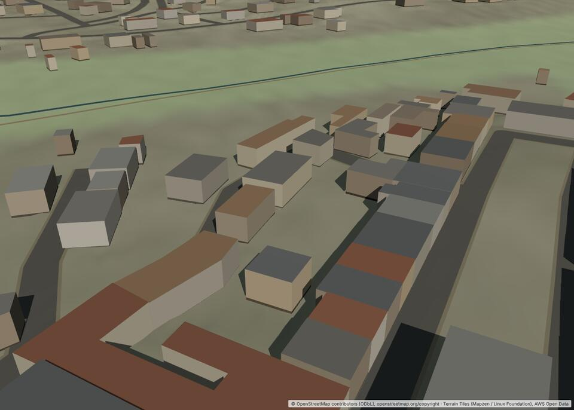
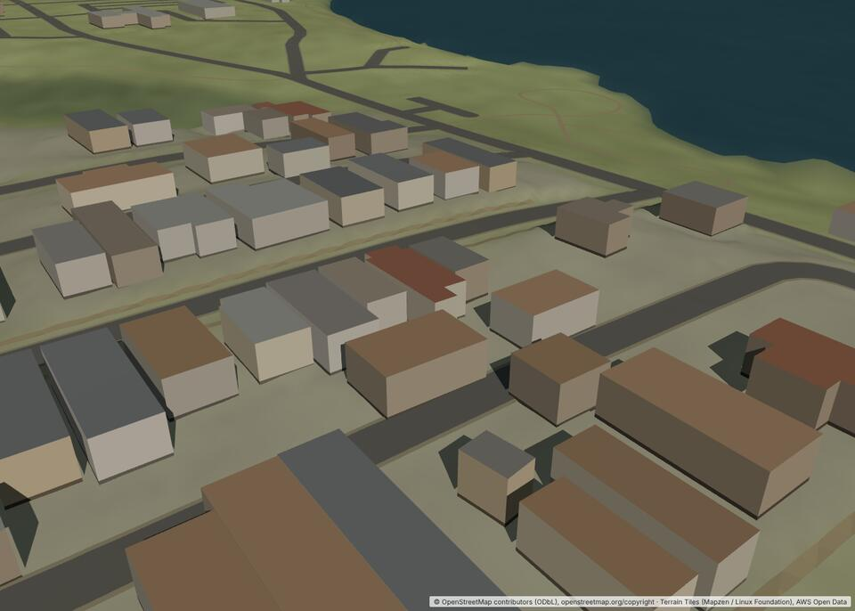
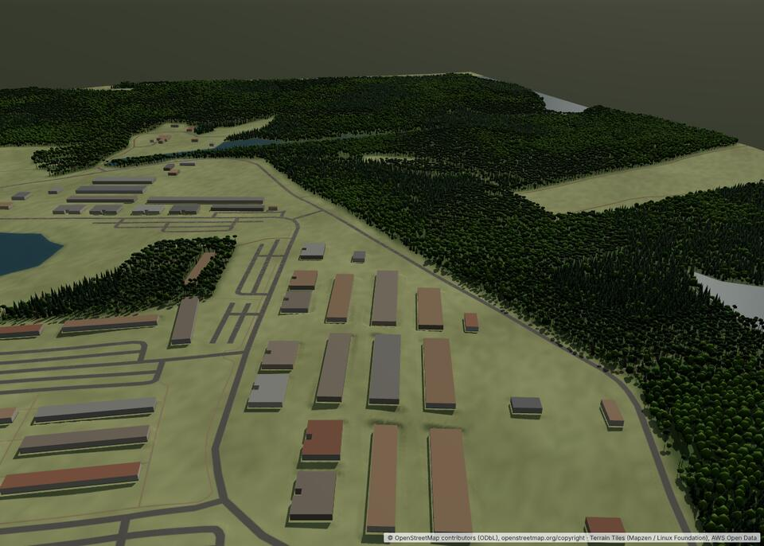
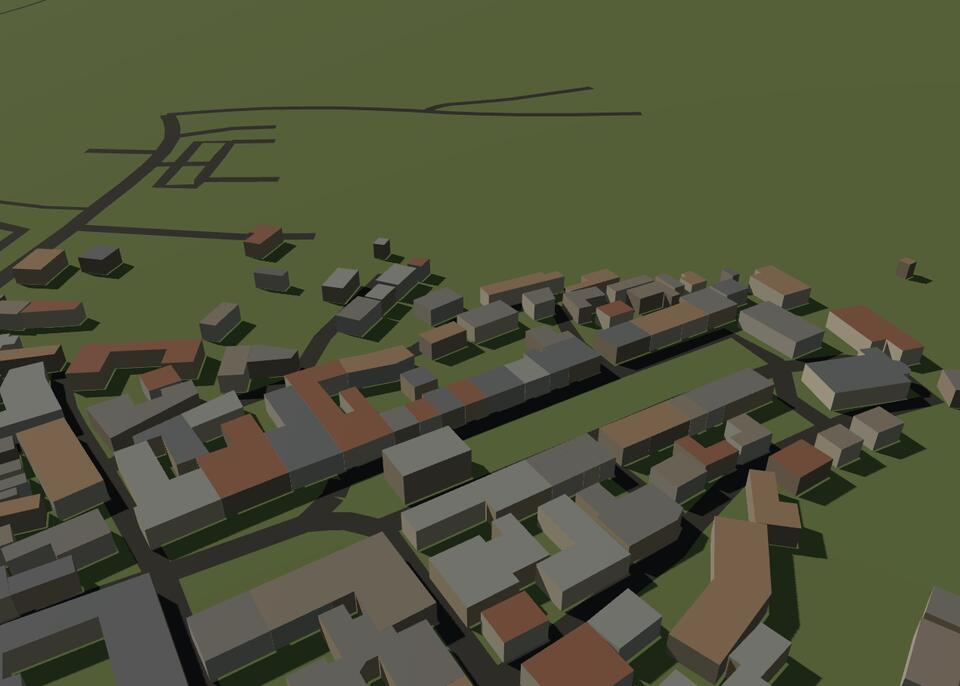
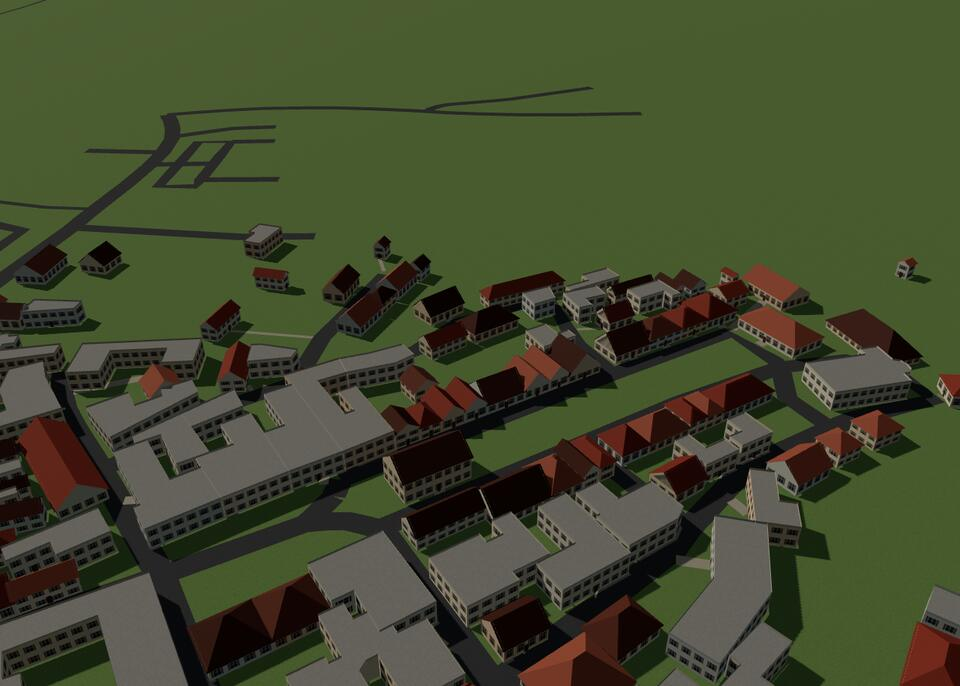
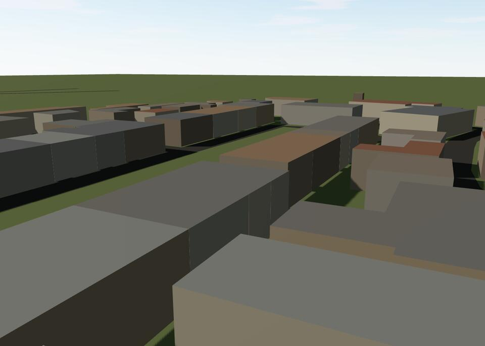
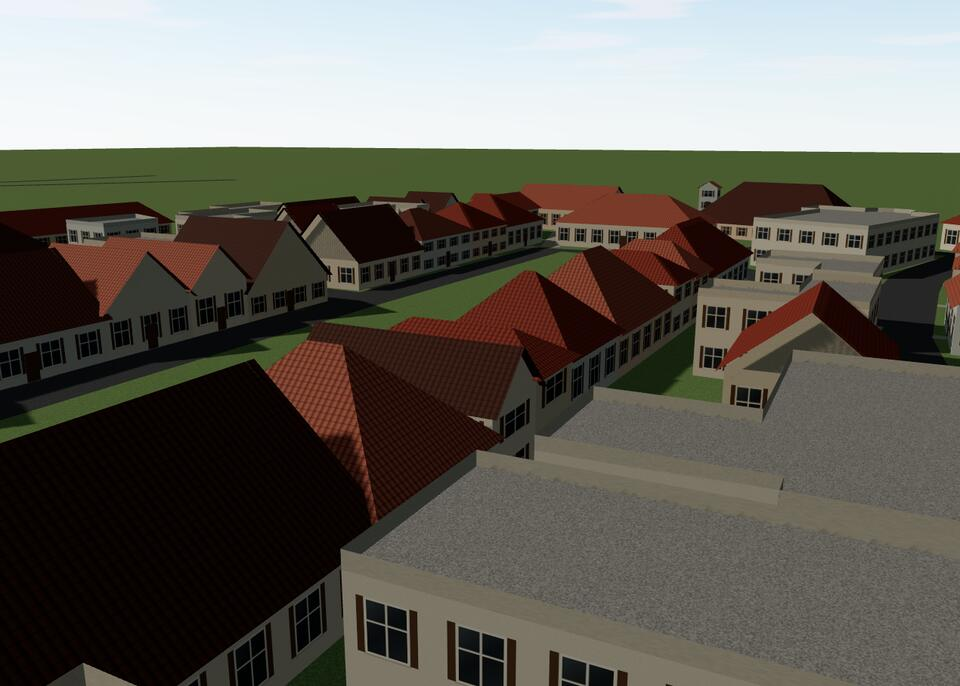
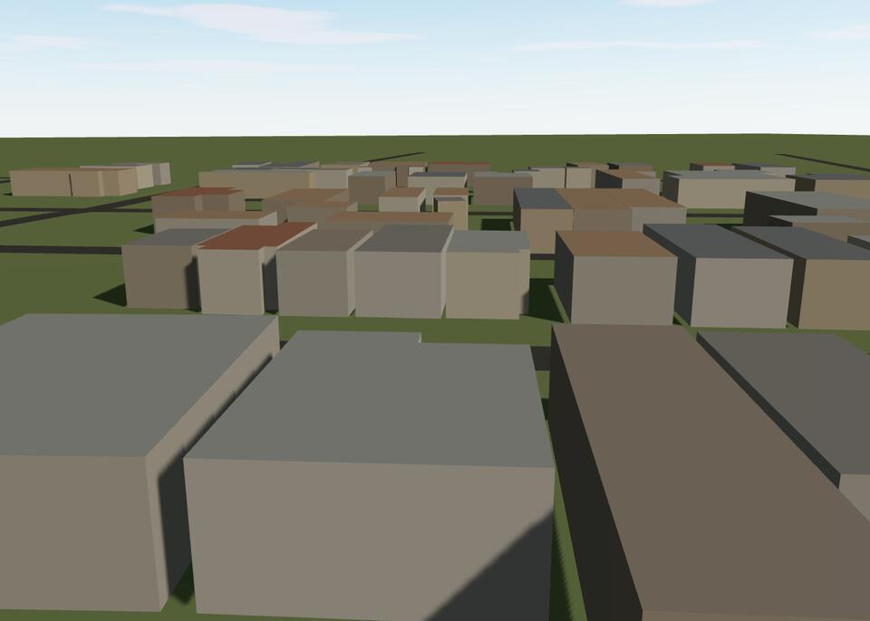
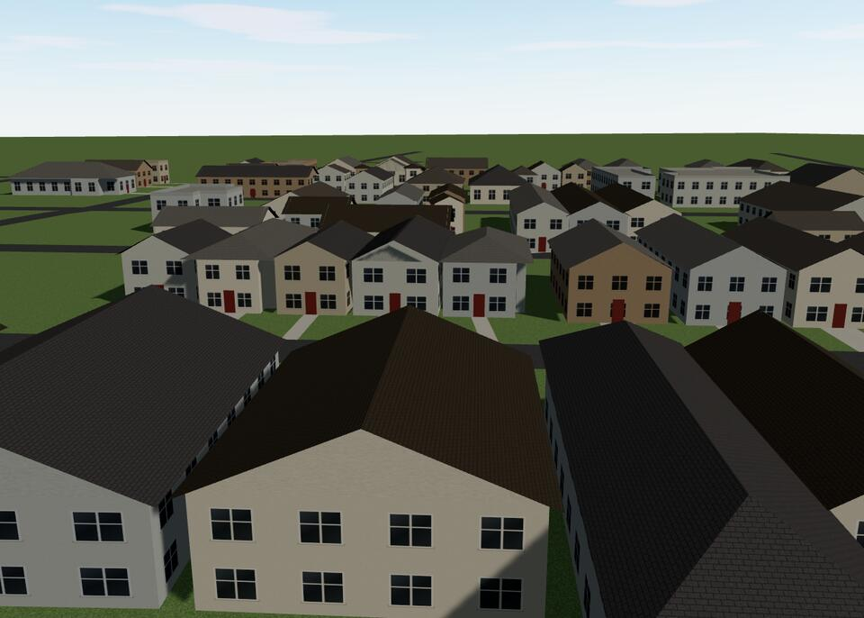

# Procedural 3D environmental realism: research and plan

- Status: Research (no production change)
- Date: 2026-10-11
- Scope: the 3D view's appearance only. Simulation, line of sight, movement and terrain grading are
  out of scope and unchanged.
- Builds on `docs/3d-terrain-architecture-research.md` and ADRs 0029 (3D view), 0030 (geographic
  features), 0031 (vegetation), 0032 (graded terrain) and 0033 (DEM quality).

How this was researched:

- Reading the current code (`src/view3d`, `src/geo/osm.ts`, `src/geo/overture.ts`).
- Measuring the recorded Quantico and Grafenwöhr battlefields: footprint shapes, tag coverage, the
  importer's query.
- Screenshots of the current build.
- An isolated prototype of roofs, textured walls, doors and driveways on real footprints (§12).
- Checking candidate libraries' licences and activity at the source (cloned repositories, npm
  registry metadata, taginfo, vendor terms pages). Anything not verified is marked
  **[unverified]**.

---

## 1. Current visual shortcomings

The images below are from the current build (high quality preset, headless Chromium with software
rendering, so slightly softer than on a GPU).

_Grafenwöhr village today: every building a flat-roofed box, uniform ground, roads as dark bands._

_Quantico housing today: the same boxes; no driveways, gardens or street detail._

_Grafenwöhr training area: the woods read well (ADR 0031); barracks, open ground and the world
beyond the edge do not._

| Shortcoming                                                  | Cause                                                                                                                                                                                                                                     | Category                                                |
| ------------------------------------------------------------ | ----------------------------------------------------------------------------------------------------------------------------------------------------------------------------------------------------------------------------------------- | ------------------------------------------------------- |
| Every building is a box with a flat roof                     | `building-geometry.ts` extrudes the footprint to a flat roof                                                                                                                                                                              | 2. Simplistic geometry                                  |
| All buildings are the same height (6 m)                      | Heights are estimated for 1,273 of 1,273 buildings at Quantico and 3,566 of 3,567 at Grafenwöhr: no `height` tag, almost no `building:levels`                                                                                             | 1. Source data                                          |
| Building type is unknown                                     | `building=yes` on 89% (Quantico) and 97% (Grafenwöhr). The importer keeps neither the `building` value, nor roof, colour or material tags, nor Overture's `class` and `roof_*` fields: `Building` holds footprint, height and source only | 1. Source data, and 2. the importer drops what there is |
| Walls and roofs are flat colours                             | Vertex colours from a 7- and 6-colour palette; no textures in the scene at all                                                                                                                                                            | 3. Weak materials                                       |
| No windows, doors, eaves or plinth detail beyond a dark band | Not modelled                                                                                                                                                                                                                              | 2, 5                                                    |
| Ground is a blur of tints                                    | Land cover as vertex colours on a 10 m grid (4× subdivided for classification), ±4% noise: no texel-level detail, soft class edges, no texture for grass, soil, gravel or asphalt                                                         | 3. Weak materials                                       |
| Roads are flat dark ribbons                                  | One colour per class, no surface texture, no markings, kerbs or sidewalks; a 0.6 m verge colour band                                                                                                                                      | 3, 5                                                    |
| Houses stand in empty grass                                  | No driveways, paths, gardens, fences or hedges. OSM has `service=driveway` (86 ways at Quantico, 76 at Grafenwöhr), but the importer folds every `highway` into 5 classes and draws driveways as ordinary paved roads                     | 1 (partly), 5. Missing detail                           |
| No street furniture                                          | Not modelled. The importer's Overpass query fetches only ways (roads, buildings, land cover, water, hedges), so street lamps, poles, power lines, fences, walls and single trees are not even downloaded                                  | 5, and 1 (the query)                                    |
| Flat, low-contrast lighting                                  | One directional sun and a hemisphere light, ACES at exposure 0.6, no environment map, no ambient occlusion; one 2048–4096 shadow map over 700–1,100 m. Materials are vertex-coloured MeshStandard at roughness 0.85–1                     | 4. Lighting                                             |
| A dark band beyond the battlefield edge                      | The surrounding plain and skirt are one flat colour, fogged only far away                                                                                                                                                                 | 4, 5                                                    |
| Constraints                                                  | About 3–4 M triangles and 12–22 draw calls at Quantico and Grafenwöhr; 0.4–3 fps under software rendering; 186–228 MB of geometry at high. Room for more draw calls, but not for more unique geometry everywhere                          | 6. Performance                                          |

Footprints suit simple roofs. Measured against their oriented minimum bounding rectangle (OMBR):

| Battlefield | Rectangular (≥ 92% of OMBR) | L or T shapes (75–92%) | Irregular | Median area | 90th percentile | Median aspect |
| ----------- | --------------------------- | ---------------------- | --------- | ----------- | --------------- | ------------- |
| Quantico    | 62%                         | 30%                    | 8%        | 193 m²      | 472 m²          | 1.29          |
| Grafenwöhr  | 78%                         | 14%                    | 8%        | 141 m²      | 376 m²          | 1.44          |

The median footprint has 4 corners. More polygons alone would not help: the largest gains come from
roofs, textures (walls, roofs, ground) and missing small objects, all of which are cheap if
batched.

## 2. Procedural building generation: options

| Option                                                          | What it is                                                                                                                         | Verdict                                                                                                  |
| --------------------------------------------------------------- | ---------------------------------------------------------------------------------------------------------------------------------- | -------------------------------------------------------------------------------------------------------- |
| A. Keep extrusion, add textures only                            | Walls with a window texture, roofs with a texture                                                                                  | Cheap, but flat roofs dominate every oblique view                                                        |
| B. Rule-based roofs on the OMBR, plus textured walls            | Gable, hip and shed roofs for rectangular footprints, flat (with parapets) otherwise. Walls UV-mapped per storey and window module | **Recommended first step.** Covers 62–78% of buildings with pitched roofs; proven in the prototype (§12) |
| C. Straight-skeleton roofs                                      | Hipped (and, by moving hip vertices, gabled) roofs on any footprint, holes included                                                | **Second step**, for the L, T and irregular 22–38%                                                       |
| D. Full grammar-based architecture (CGA, procedural extrusions) | Shape grammars as in CityEngine; twak's procedural extrusions                                                                      | Too heavy for a tactical game, and the source data does not support it (no building types)               |
| E. Hand-made building models matched to footprints              | Kits placed by footprint size                                                                                                      | Does not fit arbitrary footprints; breaks the authoritative footprint                                    |

**Building data the importer should keep.** This is a cheap importer change with a large payoff.
Extend `Building` with optional fields, all decorative, never used by the simulation:

- `kind`: the OSM `building` value or Overture `class` (house, detached, garage, shed, apartments,
  commercial, industrial, church, school, hangar, …);
- `levels`;
- `roofShape`, `roofOrientation`, `roofDirection`, `roofHeight`, `roofAngle`;
- `roofColour`, `roofMaterial`, `wallColour`, `wallMaterial`;
- `name`, `amenity`/`shop`, `military`.

Overture's schema (v2.0.0) carries `class`, `num_floors`, `roof_shape`, `roof_direction`,
`roof_orientation`, `roof_height`, `roof_material`, `roof_color`, `facade_material` and
`facade_color` ([docs](https://docs.overturemaps.org/schema/reference/buildings/building/)). That
needs an importer version bump; old packages fall back to the defaults below.

Tag coverage is low, so defaults matter more than tags:

- **taginfo (2026-10-10):** of about 711 M buildings, `roof:shape` is on 9.76 M (≈1.4%) and
  `building:levels` on 43.4 M (≈6.1%). Tagged roofs are 56% gabled, 21% flat and 10% hipped.
- **At these two sites:** `roof:shape` is on 4 of 3,609 buildings and `building:levels` on 12.

## 3. Roof generation

### 3.1 OMBR ridge roofs (gable, hip, half-hip, shed)

1. **Simplify** the footprint (merge collinear edges).
2. **OMBR:** convex hull, then rotating calipers. Test each hull edge's direction, keeping the
   smallest-area box. Reference: Streets GL's `src/lib/math/OMBB.js`, MIT.
3. **Use it** when the footprint fills ≥ 88–92% of the OMBR and is not large (≤ 600–700 m²
   residential, or by `kind`). Otherwise go to §3.2 or a flat roof.
4. **Ridge** along the long axis, or across when `roof:orientation=across`; the direction comes from
   `roof:direction` when tagged. OSM2World's `RoofWithRidge` does the same: it intersects a long
   line through the centre with the simplified polygon to find the ridge ends, and is MIT since
   February 2026.
5. **Pitch** by style (§2.5). Rise = tan(pitch) × half the span, unless `roof:height` or
   `roof:angle` is tagged.
6. **Faces.**
   - Gable: two slopes, plus two wall-coloured gable triangles.
   - Hip: the ridge is inset at both ends by half the span (a true 45° hip on a rectangle; OSM2World
     uses 1/3 of the cap). That gives two trapezoids and two triangles.
   - Half-hip: the hip is cut at 50–70% of the rise.
   - Shed (skillion): a single plane sloping along `roof:direction`, or across the short axis.
7. **Overhang** 0.3–0.6 m on all sides. Fascia: a 0.15–0.25 m vertical band along the eaves edge.
   Gutter: a thin half-cylinder or just a dark line in the fascia texture. A soffit closes the
   overhang from below.

The prototype implements steps 2–7 except the fascia and soffit, in about 120 lines.

### 3.2 Straight-skeleton roofs (arbitrary footprints)

- **Hipped:** each skeleton face rises at its distance from its edge. Scale it to `roof:height`, or
  set the angle from `roof:angle`.
- **Gabled:** move the hip vertices out to the wall, as Streets GL's `GabledRoofBuilder` (MIT) does.
- **Holes** are supported, so courtyards could be kept again in the future.
- **Failures:** skeletons can fail on degenerate input. Wrap the call in try/catch and fall back to
  flat, as Streets GL does.
- **Library:** the safe choice is `straight-skeleton@1`, pure TypeScript, MIT. It is a port of
  reinterpretcat/csharp-libs (Apache-2.0), itself a port of kendzi-math (BSD), so keep their
  notices. `straight-skeleton` v2 and v3 wrap **CGAL compiled to WebAssembly, which is GPL-3.0**,
  despite the package's MIT label (§9).
- **Where it runs:** in the generation worker, chunked.

### 3.3 Flat roofs

- **Flat with a parapet**: a 0.5–1.0 m upstand inset 0.25 m, with a coping colour. Use it for large,
  commercial, industrial, military and irregular buildings.
- **Details**: optional rooftop boxes (HVAC units, stair heads) as instanced props on large roofs.

### 3.4 Choosing a roof when nothing is tagged

Both reference engines (Streets GL and OSM2World) default to flat, which is why their untagged towns
look flat. A deterministic heuristic, keyed by a hash of the building id:

| Condition                                                                  | Roof                                                              |
| -------------------------------------------------------------------------- | ----------------------------------------------------------------- |
| `roof:shape` tagged                                                        | As tagged                                                         |
| `kind` industrial, commercial, retail, warehouse, hangar, or area > 700 m² | Flat with parapet; low-pitch shed or sawtooth for some industrial |
| `kind` garage, shed, carport, or area < 30 m²                              | Shed or flat                                                      |
| OMBR fill ≥ 0.9, area ≤ 700 m²                                             | Gable or hip: US 70/30, central European 60/30/10 with half-hip   |
| L, T or irregular, area ≤ 700 m²                                           | Straight-skeleton hip (§3.2), else flat                           |
| Military landuse, long barracks (aspect > 3)                               | Gable, low pitch, uniform materials                               |

### 3.5 Consistency with the simulation

- **What the simulation uses:** line of sight uses one roof height per building. In
  `buildingRoofElevations`, that is the lowest ground at the corners plus `heightMeters`; the
  volume is a flat-topped prism.
- **The rule:** the visual roof's **mean height equals the simulated height**. The eaves are at
  `H − rise/2` and the ridge at `H + rise/2`, so the volume above the footprint is unchanged.
  - Eaves are kept at least 2.6 m above the ground, which limits the rise for low buildings.
  - When `roof:height` is tagged, the eaves are at `H − roof:height` and the simulated prism
    height should not change.
- **Acceptable discrepancy:** at most half the rise, typically 1–2.5 m at the ridge (above the
  volume) and the same at the eaves (below it). Roofs are not used for cover or observation in the
  simulation, so this does not change who can see whom in any way a trainee could exploit beyond
  that 1–2.5 m band. It is documented, not hidden.
- **Overhang** extends past the footprint by less than 0.6 m, which is visual only.
- The prototype follows this rule.

## 4. Windows, doors and materials

**Approach: texture modules in a texture array, not geometry.**

- **Walls are UV-mapped in metres.**
  - U runs along the wall in window modules: `n = floor(length / moduleWidth)` modules, stretched
    by at most ±15% so they fit whole.
  - V counts storeys: `floors = round(eavesHeight / storeyHeight)` (2.8–3.0 m).
  - One texture tile is therefore one window × one storey, as in Streets GL's builder (MIT). Each
    wall vertex carries a layer index into a `sampler2DArray`.
- **Layers** cover each wall material with and without windows (brick, plaster, timber siding,
  concrete, metal cladding), ground-floor variants (door, shopfront, garage door) and gable or blank
  walls.
- **Short walls** (fewer than one module) use the blank layer, so no window is ever cut in half.
- **Corners:** the module stretch keeps windows away from corners. Use at least 0.6 m clearance;
  drop a module if the clearance would be less.
- **Doors** sit on the wall facing the nearest suitable road (§5), on the ground storey: one door
  module per house, and a garage-door module for `kind=garage` or for wide US houses on the
  driveway side.
- **Shopfronts** cover the whole ground storey for `kind` retail/commercial or `shop` and `amenity`
  buildings.
- **Industrial:** cladding with roller doors on the longest road-facing wall.
- **Geometry vs texture vs shader:**

  | Method         | Pros                                                                  | Cons                                           |
  | -------------- | --------------------------------------------------------------------- | ---------------------------------------------- |
  | Geometry       | Parallax up close                                                     | 10–100× triangles                              |
  | Decals         | —                                                                     | One draw per decal set; sorting and z-fighting |
  | Atlas texture  | One draw, cheap                                                       | Mip bleeding                                   |
  | Texture array  | One draw, no bleeding (WebGL2 `DataArrayTexture`); used by Streets GL | —                                              |
  | Shader windows | Infinite variety                                                      | Harder to art-direct                           |

  At tactical camera distances (30–2,000 m) a texture with a normal map is indistinguishable from
  geometry. OSM2World offers flat, inset and geometry windows; inset (a normal or parallax map) is
  the useful middle ground.

- **Variation.** Hash the building id to choose:
  - wall material and tint (a small curated palette per style);
  - roof material and colour;
  - window module variant (sizes, shutters on 30% of central-European houses, mullions);
  - door colour.

  Night lighting, which Streets GL uses, needs only an emissive mask in the same array.

- **Materials:**
  - Roofs: clay pantile, plain tile, slate, asphalt shingle, standing-seam metal, corrugated metal,
    concrete or gravel (flat).
  - Walls: brick, stucco/plaster, render, concrete, timber siding, stone, metal cladding.
  - Each material is albedo plus a packed normal and roughness map, at 512 px (1024 px for the most
    common), in **KTX2** (Basis Universal ETC1S for albedo, UASTC for normals). That is about 4–8×
    less GPU memory than RGBA8, which matters on integrated GPUs.

### 4.1 Regional styles

The style is chosen per battlefield from its centre: US/Canada, central Europe, and a generic
fallback. Building `kind` and land use then refine it per building.

| Style                    | Roofs                                                                        | Walls                                                    | Windows                         | Colours                                          |
| ------------------------ | ---------------------------------------------------------------------------- | -------------------------------------------------------- | ------------------------------- | ------------------------------------------------ |
| US suburban and rural    | Gable 22–32°, some hip; asphalt shingles, some metal                         | Vinyl/timber siding, brick, stucco                       | Double-hung, with a garage door | Whites, greys, beiges; dark grey and brown roofs |
| Central European village | Gable and half-hip 35–48°, some hip; clay tiles, some slate or concrete tile | Render/plaster in pastels, some stone and timber framing | Casement, shutters              | Terracotta, anthracite                           |
| Industrial               | Flat, low-pitch, sawtooth; metal                                             | Cladding, concrete                                       | Strip windows, roller doors     | Greys, muted blue and green                      |
| Agricultural             | Gable, low pitch; corrugated metal                                           | Timber, metal                                            | Few windows, large doors        | Red, grey, weathered                             |
| Military installation    | Uniform low gable or flat                                                    | Concrete, render                                         | Regular grids                   | Olive, grey, cream; very low variation           |

`landuse=military` (9 areas at Grafenwöhr, 2 at Quantico) switches buildings inside it to the
military style, whatever the region.

## 5. Footpaths and driveways

These are decorative, inferred geometry, never simulation roads (§10).

1. **Use mapped data first.**
   - Keep `service=driveway` and `highway=footway`/`sidewalk` from OSM, as a decorative "minor"
     road layer drawn narrower. That needs an importer change: today they become `paved` and
     `path`.
   - Infer a driveway only for buildings with no mapped one.
2. **Which buildings.**
   - Residential `kind` or residential land use, and area 40–700 m².
   - Not garages that already touch a road, nor buildings over 700 m², nor military, industrial or
     agricultural buildings (they get yards or aprons instead; see below).
   - Not buildings more than 40 m from the nearest suitable road.
   - Suitable roads are paved or unpaved, not major, track or path.
3. **Entrance.**
   - Score each wall edge of at least 2.5 m by how directly its outward normal faces the nearest
     road point, plus a small bonus for length.
   - The door goes at the best edge's middle, or at a third of it on long walls.
4. **Route.**
   - A straight segment from the door to the nearest point on the road edge (centreline offset by
     half the road width).
   - Rejected if it crosses another footprint, water, a waterway, or a slope over 25%, or if the
     road point is more than 40 m away.
   - Otherwise try the second-best wall, else nothing.
   - The prototype does this with segment sampling (§12). Production should use the existing
     spatial index (`spatial-index.ts`).
5. **Appearance.**
   - US: a 3.0 m concrete driveway (houses) plus a 1.2 m walk.
   - Central European village: 1.2–1.5 m paved or gravel paths, and gravel or paving for
     farmyards.
   - Rural houses: a gravel or dirt track.
6. **Rendering.** Draped through the existing draper (`drape.ts`, which follows the graded
   surface) as a separate decorative layer, with a small offset and `polygonOffset`. It ends at the
   road's verge, never on the carriageway.
7. **Large buildings.** Industrial, military and agricultural buildings get a paved apron or yard,
   a footprint buffer clipped to the plot, on their road-facing side instead.

## 6. Roadside objects

Placement walks each road centreline at a spacing with a deterministic jitter (hash of road id and
distance), offset to a side at `width/2 + verge + setback`. A spatial-index test rejects any spot
within 1 m of a building, inside water, on another road, or on a slope over 30%. All of it is
decorative and never enters the simulation.

| Object             | Where                                                                                                          | Spacing                      |
| ------------------ | -------------------------------------------------------------------------------------------------------------- | ---------------------------- |
| Streetlights       | Paved roads in residential or commercial land use, or with `lit=yes`; never on tracks or woodland roads        | 30–40 m, one side, staggered |
| Utility poles      | Rural paved roads (US: wooden poles with wires; Europe: fewer, concrete or wood)                               | 40–60 m, one side            |
| Road signs         | Junctions of major or paved roads (stop and give way), curves on major roads                                   | Per junction or curve        |
| Roadside trees     | Residential streets, European village streets, avenues along major roads (an avenue only if mapped `tree_row`) | 8–15 m, both sides           |
| Hedges, fences     | Plot edges, inferred from building position relative to the road; prefer mapped `barrier=*`                    | Along plot lines             |
| Guardrails         | Major roads on embankments over 1.5 m (the grading knows), and bridges or culverts                             | Continuous                   |
| Bollards and kerbs | Commercial areas, sidewalks                                                                                    | 1.5–2 m                      |
| Small structures   | Mailboxes (US houses, by the driveway), bins, bus shelters (mapped `highway=bus_stop`)                         | Per house or stop            |

Where available, OSM data replaces inference: `highway=street_lamp`, `power=pole/line/minor_line`,
`barrier=*`, `natural=tree`, `highway=bus_stop`. All of these need the Overpass query to fetch
**nodes** and more `barrier`/`power` ways. That is an importer change; check the size of the
response at 5 km first.

**Rendering:**

- One `InstancedMesh` per asset and LOD, built in the existing generation worker and selected per
  250 m tile with the existing vegetation LOD machinery (`vegetation-lod.ts`).
- Wires between poles: one `LineSegments` mesh or thin ribbons, faded beyond about 300 m.
- About 10–20 asset kinds × 2 LODs gives 20–40 draw calls.

## 7. Ground materials

A custom terrain shader is justified: it is the single largest visual gain after roofs, at about
6–10 texture fetches per fragment. The design:

- **Land-cover splat weights** come from the existing land-cover classification
  (`landcover.ts`). Bake two RGBA8 weight textures (up to 8 layers) at 1024² for 5 km (about
  5 m/texel), linearly filtered. An alternative is an R8 index map with manual bilinear blending,
  which scales to 16+ classes.
- **Layers** go in a `DataArrayTexture` or KTX2 array: grass/meadow, farmland (soil with rows),
  forest floor, gravel/bare soil, built-up ground (mixed grass and paving), wetland, rock, sand.
  Each layer has albedo, packed normal and roughness.
- **Tile-breaking:** Inigo Quilez's "virtual pattern" variant (2 fetches;
  [texture repetition](https://iquilezles.org/articles/texturerepetition/)) with `textureGrad`.
  Avoid the 9-fetch Voronoi variant. Heitz–Neyret histogram-preserving blending is better but needs
  preprocessing.
- **Macro variation:** a 1–2 km-scale noise texture multiplying albedo, plus 2–3 octaves of UV
  scale. Fade detail and normal maps to macro colour beyond 300–800 m: the "basemap" idea of Unity
  and Godot terrains.
- **Slope:** a rock or soil layer where the normal's y < 0.7, or for embankments and cuttings (the
  grading knows where they are). Triplanar only for that layer; a 10 m DEM rarely needs it.
- **Roads:** keep the draped meshes (§1). Add:
  - asphalt or gravel texture by UV;
  - procedural centre and edge lines with `smoothstep` and `fwidth` on U, dashes by `fract` on V;
  - alpha falloff in the outer 10–20% of U;
  - a soil-coloured shoulder baked into the splat weights under the road.
- **Implementation:** extend `MeshStandardMaterial` through `onBeforeCompile` (with
  `customProgramCacheKey`), or through
  [three-custom-shader-material](https://github.com/FarazzShaikh/THREE-CustomShaderMaterial) `/vanilla`
  (MIT, v6.4.0, October 2025). This keeps three's lights, shadows and fog. If cascaded shadow maps
  are adopted, chain the hooks: three's `CSM.setupMaterial()` sets `onBeforeCompile` itself
  (verified in r186).
- **Not now:** TSL and WebGPU node materials (they would mean rewriting the post-processing
  stack), blade grass, and physically based atmosphere.

## 8. Lighting and atmosphere

In order of value per cost:

1. **Environment lighting.** Render the existing `Sky` into `PMREMGenerator.fromScene()` once (and
   whenever the sun changes), as `scene.environment`. This replaces the hemisphere light as the
   main fill and gives sky-coloured ambient light and specular. It costs a few milliseconds once.
2. **Tone mapping.** Switch to **AgX** or **Neutral** (three r160+). ACES at exposure 0.6 shifts
   hues and oversaturates greens; AgX suits muted military terrain. It is free.
3. **Shadows.** Use cascaded shadow maps (three's `examples/jsm/csm/CSM.js`, in r186): 3 cascades
   at 2048², `maxFar` 1.5–2 km, with splits near 60, 300 and 1,500 m. Trees cast only in the first
   two cascades. Integrated-GPU preset: 2 cascades at 1024–2048, or the current single map.
4. **Height fog / aerial perspective.** Exponential height fog in the fragment shader (as in
   three's `webgpu_fog_height` example). Fog colour should come from the sky toward the sun. The
   edge-of-world band then fades properly.
5. **Ambient occlusion.**
   - [N8AO](https://github.com/N8python/n8ao) (CC0/ISC, v2.0.1, August 2026) at half resolution,
     desktop presets only. It grounds buildings and trees; modest value from high, oblique views.
   - Cheaper: bake AO into building vertex colours (darker at the base and under eaves), and into
     the terrain macro texture under woods.
6. **Anti-aliasing.** Native MSAA if there is no post-processing. With post-processing,
   [pmndrs/postprocessing](https://github.com/pmndrs/postprocessing) (Zlib, v6.39.5, peer
   `three <0.187`) SMAA plus tone mapping in one merged pass.
7. **Material response.** With the environment map, set real roughness (shingles 0.85, metal 0.4,
   glass 0.1 through the window mask) so roofs and windows catch the sky.

## 9. Open-source libraries and licensing

| Project                                                                                    | Licence                                     | Last activity                | Relevant                                                                                                                                                                      | Modern Three.js?                                | Arbitrary footprints             | Integration                               | Reuse                                                                                   |
| ------------------------------------------------------------------------------------------ | ------------------------------------------- | ---------------------------- | ----------------------------------------------------------------------------------------------------------------------------------------------------------------------------- | ----------------------------------------------- | -------------------------------- | ----------------------------------------- | --------------------------------------------------------------------------------------- |
| [Streets GL](https://github.com/StrandedKitty/streets-gl)                                  | MIT                                         | 2025-08-21                   | 15 roof builders (hipped and gabled from the skeleton, OMBB-oriented gabled, gambrel, mansard, saltbox…), window-module wall UVs, texture-array facades, worker tile batching | Own WebGL2 engine; builders are plain TS arrays | Yes (holes too)                  | Medium: port the builders, not the engine | Code, keeping the notice. Facade textures' licence is **not stated**: do not reuse them |
| [straight-skeleton](https://github.com/StrandedKitty/straight-skeleton) v1                 | MIT (+ Apache-2.0 and BSD notices upstream) | v1 branch; v3.0.0 2026-03-24 | Pure-TS straight skeleton with holes                                                                                                                                          | Engine-free                                     | Yes                              | Low                                       | Code. **v2/v3 = CGAL WASM, GPL-3.0**: do not ship unless GPL is acceptable              |
| [OSM2World](https://github.com/tordanik/OSM2World)                                         | **MIT** since 2026-02-13 (LGPL before)      | 2026-09-08                   | 20 roof types (`RoofWithRidge`, half-hipped, sawtooth, complex from `roof:ridge`), building defaults by type, window implementations (flat, inset, geometry)                  | Java                                            | Near-rectangular for ridge roofs | Algorithm port                            | Code (post-2026 MIT). Its default textures are CC0                                      |
| [OSMBuildings](https://github.com/OSMBuildings/OSMBuildings)                               | BSD-2-Clause / MIT                          | 2020-10 (dormant)            | Compact JS ridge roofs                                                                                                                                                        | Own engine                                      | Ridge roofs only                 | Reference                                 | Code                                                                                    |
| twak campskeleton / chordatlas                                                             | Apache-2.0                                  | 2023 / 2024                  | Weighted skeletons, procedural extrusions                                                                                                                                     | Java                                            | Yes                              | High                                      | Reference                                                                               |
| CGAL Straight_skeleton_2                                                                   | GPL-3.0 or commercial                       | Active                       | Robust skeletons                                                                                                                                                              | C++/WASM                                        | Yes                              | —                                         | **Not** without GPL                                                                     |
| polyskel (Python), BlenderGIS                                                              | LGPL-3.0 / GPL-3.0                          | 2020 / 2025                  | Skeletons, OSM import in Blender                                                                                                                                              | —                                               | —                                | —                                         | Algorithm reference only                                                                |
| [THREE.Terrain](https://github.com/IceCreamYou/THREE.Terrain)                              | MIT                                         | npm 3.1.1, 2026-08-27        | Height-blended terrain material (Lambert)                                                                                                                                     | r160+                                           | —                                | Low                                       | Reference                                                                               |
| [three-landscape](https://github.com/nwpointer/three-landscape)                            | MIT (example textures excluded)             | 2023-03 (stale)              | Splatting, stochastic sampling, triplanar on MeshStandard                                                                                                                     | R3F only                                        | —                                | Read, don't depend                        | Code                                                                                    |
| [three-custom-shader-material](https://github.com/FarazzShaikh/THREE-CustomShaderMaterial) | MIT                                         | v6.4.0, 2025-10-12           | Extends MeshStandard with custom shader code                                                                                                                                  | three ≥ 0.159                                   | —                                | Low                                       | Dependency (optional)                                                                   |
| [N8AO](https://github.com/N8python/n8ao)                                                   | CC0-1.0 (LICENSE) / ISC (package.json)      | v2.0.1, 2026-08-10           | High-quality SSAO                                                                                                                                                             | WebGL2                                          | —                                | Low                                       | Dependency (optional)                                                                   |
| [pmndrs/postprocessing](https://github.com/pmndrs/postprocessing)                          | Zlib                                        | v6.39.5, 2026-09-09          | SMAA, tone mapping, merged passes                                                                                                                                             | three ≥ 0.168 < 0.187                           | —                                | Low                                       | Dependency (optional)                                                                   |
| [procedural-gl-js](https://github.com/felixpalmer/procedural-gl-js)                        | MPL-2.0                                     | 2021 (inactive)              | Map engine                                                                                                                                                                    | —                                               | —                                | —                                         | Reference                                                                               |
| three.js examples (r186)                                                                   | MIT                                         | Current                      | `webgl_texture2darray_compressed`, `webgl_shadowmap_csm`, `webgl_batch_lod_bvh`, `webgl_postprocessing_gtao`, `webgl_tonemapping`, Sky                                        | Yes                                             | —                                | Low                                       | Code                                                                                    |

Notes:

- **Licence traps.** The `straight-skeleton` package's MIT label does not cover the GPL
  CGAL inside its v2/v3 WASM; Streets GL's facade textures have no stated licence.
- **OSM2World** changed from LGPL to MIT on 2026-02-13 with all contributors' agreement (commit
  `92f24922`). Only code from after that date is MIT.

## 10. Assets and textures

Licences and terms were checked on each source's licence page, with API queries, and by
downloading packs (Kenney) to count triangles.

| Source                                                                 | Licence                                                                                                                                                    | Redistribute in the repo                               | What fits                                                                                                                                                                                                                                                                                                                            | Size                                                       |
| ---------------------------------------------------------------------- | ---------------------------------------------------------------------------------------------------------------------------------------------------------- | ------------------------------------------------------ | ------------------------------------------------------------------------------------------------------------------------------------------------------------------------------------------------------------------------------------------------------------------------------------------------------------------------------------ | ---------------------------------------------------------- |
| [ambientCG](https://docs.ambientcg.com/license/)                       | CC0 1.0; credit optional                                                                                                                                   | Yes                                                    | 2,015 PBR materials. Asphalt and Road (with markings), Gravel, Ground, Grass, ScatteredLeaves, Bricks, Plaster, PaintedPlaster, Concrete, WoodSiding (some shingles), CorrugatedSteel, SheetMetal, RoofingTiles001–015, Fence (alpha). OSM2World's default style uses these.                                                         | 1K zip about 6.7 MB, of which about 3.3 MB are useful maps |
| [Poly Haven](https://polyhaven.com/license)                            | CC0 for assets. Its **API** requires a User-Agent naming the app, and products showing live API content must credit "Powered by Poly Haven"                | Yes (bundle files; don't fetch at runtime)             | 867 textures: asphalt_01–07, gravel_road, forest_floor, farm_soil, farm_furrows, sparse/leafy grass, brick_wall_0xx, white_stucco, plastered_wall, weathered_plank_siding, corrugated_iron, clay_roof_tiles, roof_slates, bitumen. No asphalt shingle or standing-seam roof. Its models are 30k–200k polygons, too heavy to instance | 1K (diffuse, normal, ARM as JPG) 0.4–3.6 MB per material   |
| [Kenney](https://kenney.nl/support)                                    | CC0 (License.txt in each pack); don't use the logo                                                                                                         | Yes                                                    | **City Kit Roads**: electricity poles and wires (176–544 triangles), 2 streetlights (60–92), stop, warning and street signs (104), traffic lights, dumpster, barriers. **City Kit Suburban**: fences (88–180), driveways, paths, planters. **Nature Kit**. One shared colour map                                                     | Packs about 3 MB each                                      |
| [Quaternius](https://quaternius.com/faq.html)                          | CC0, no attribution                                                                                                                                        | Yes (CC0; raw redistribution not addressed in the FAQ) | Ultimate Nature (150), Ultimate Stylized Nature (63, glTF with textures), Modular Streets (25)                                                                                                                                                                                                                                       | —                                                          |
| [OSM2World default style](https://tiles.osm2world.org/styles/default/) | CC0 (COPYING.txt)                                                                                                                                          | Yes                                                    | Its ambientCG selection (Plaster002, RoofingTiles010, WoodSiding008, Bricks029, CorrugatedSteel005), **window textures** (`custom/Windows`), and **German road-sign textures** (`signs-DE`)                                                                                                                                          | —                                                          |
| 3dtextures.me, cgbookcase                                              | CC0                                                                                                                                                        | Yes                                                    | Extra materials                                                                                                                                                                                                                                                                                                                      | —                                                          |
| KayKit                                                                 | CC0                                                                                                                                                        | Yes                                                    | Chunky toy style: **does not match**                                                                                                                                                                                                                                                                                                 | —                                                          |
| ShareTextures                                                          | "CC0" **with** a no-redistribution clause                                                                                                                  | **No**                                                 | —                                                                                                                                                                                                                                                                                                                                    | —                                                          |
| Textures.com, Fab/Megascans                                            | Proprietary; open-source release prohibited (Textures.com FAQ, from a search snippet); Fab forbids free standalone redistribution **[partially verified]** | **No**                                                 | —                                                                                                                                                                                                                                                                                                                                    | —                                                          |
| Sketchfab, OpenGameArt, Poly Pizza                                     | Mixed per asset (CC0, CC-BY, CC-BY-SA, GPL)                                                                                                                | Only with per-asset tracking                           | Avoid as a default                                                                                                                                                                                                                                                                                                                   | —                                                          |
| Streets GL textures and models                                         | **No licence stated**                                                                                                                                      | **No** (ask the author)                                | —                                                                                                                                                                                                                                                                                                                                    | —                                                          |

Gaps: there are no CC0 low-rise house facade atlases (the usual approach, as in OSM2World, is a wall
material plus a small window texture per bay), and no CC0 low-poly guardrail, chain-link or rail
fence, mailbox, hedge or bus stop. Build those procedurally (an extruded W-beam along a polyline, a
leaf-textured box for hedges, alpha-masked fence quads), as OSM2World's `BarrierModule` and Streets
GL do.

**Recommended coherent style: stylised-realistic, two families only.**

- **Materials:**
  - 20–25 CC0 PBR materials, mainly ambientCG to match OSM2World's proven set, plus Poly Haven
    where ambientCG lacks one.
  - Shipped as albedo, NormalGL and packed ORM, at 512 px (1,024 px for terrain and roads), in
    KTX2.
  - Colour-graded once to one muted palette.
  - About 10–20 MB to download; about 100 MB of 1K sources before conversion, kept outside the
    repo with a manifest.
- **Windows and doors:** a small custom 1,024² atlas (under 1 MB), authored, or derived from the
  OSM2World CC0 window textures.
- **Models:** one low-poly family, Kenney City Kit Roads, Suburban and Nature (CC0, 60–550
  triangles each). Repaint its shared colour map toward the muted palette so the props sit on PBR
  ground. Keep the ADR 0031 procedural trees, which already match. Generate guardrails, hedges and
  fences procedurally.
- **Do not mix in** KayKit (toy style) or Poly Haven models (photoreal, 30k–200k polygons).
- **Total payload:** roughly 15–30 MB, cached by the browser or the service worker.
- **Credits:** a courtesy `CREDITS` file: "Textures: ambientCG.com and Poly Haven (CC0). Models:
  Kenney.nl (CC0). Sign textures: OSM2World standard style (CC0)." The OpenStreetMap (ODbL) credit
  stays mandatory.

**OSM roadside data, planet-wide (taginfo, 2026-10-11).** Mapped data is sparse compared with the
features it describes, so inference stays necessary:

| Tag                   | Count  |
| --------------------- | ------ |
| `highway=street_lamp` | 6.56 M |
| `power=pole`          | 21.0 M |
| `power=line`          | 1.18 M |
| `power=minor_line`    | 1.66 M |
| `barrier=fence`       | 9.70 M |
| `barrier=hedge`       | 4.38 M |
| `barrier=wall`        | 6.23 M |
| `barrier=guard_rail`  | 232 k  |
| `service=driveway`    | 19.4 M |
| `building=house`      | 68.6 M |
| `footway=sidewalk`    | 8.53 M |
| `natural=tree`        | 34.5 M |
| `highway=bus_stop`    | 4.18 M |

OSM2World places street furniture only from mapped nodes. Streets GL instances mapped trees,
hydrants, poles, benches and bus stops, and scatters forests in polygons. Neither infers missing
lamps or driveways; that is new work here (§5, §6).
[osm2streets](https://github.com/a-b-street/osm2streets) (Apache-2.0) derives lane-level road
polygons, with sidewalks, from tags, and could later replace the simple road ribbons.

## 11. Performance architecture

The current architecture fits this well. Generation already runs in a worker
(`generation.worker.ts`). Vegetation already uses per-tile LOD selection with instancing. Features
are already merged into one mesh per layer.

- **Buildings:**
  - One merged mesh per 250 m tile for walls and roofs (two materials, or one texture-array
    material), built in the worker. That is about 400 tiles at 5 km, frustum-culled per tile.
    `BatchedMesh` (r159+) is the alternative, but its draw-call savings need `WEBGL_multi_draw`,
    which Firefox lacks.
  - **LOD:**
    - Near (under 600 m): full roof and textured walls.
    - Mid (600–1,500 m): the same geometry, cheaper shader (no normal map).
    - Far: a merged low-detail version (flat-coloured roof planes) or the current box.
  - **Cost:** roof geometry adds about 10–20 triangles per building. Measured in the prototype:
    129 buildings went from 4,170 to 6,988 triangles, including doors and driveways. For 3,567
    buildings that is about +80k triangles, small next to 3–4 M for terrain and trees.
- **Textures:**
  - One wall array and one roof array (16–32 layers × 512 px, KTX2), and one terrain array
    (8 × 1024 px).
  - Roughly 20–40 MB of GPU memory compressed, against 80–160 MB uncompressed.
  - Use mipmaps and anisotropy `min(8, max)`.
- **Roadside objects and props:** instanced per kind and LOD, per tile, as vegetation is. Placement
  goes in the same worker pass as trees so exclusions are shared.
- **Persistent caching:** generated geometry is deterministic from the terrain fingerprint, the
  terrain model and the generator version. It could be cached in IndexedDB, but generation is
  already about 6 s in the worker at Quantico, so defer this until it is measured as a problem.
- **Budgets** (keep the existing quality presets):
  - Draw calls: ≤ 80 at high, ≤ 40 at low.
  - Triangles: ≤ 5 M at high.
  - Texture memory: ≤ 64 MB at low.

## 12. Proof of concept

An isolated prototype was built and rendered, using none of the production code:

- **Location:** the session's scratchpad; the source is not committed.
- **Rendering:** a standalone page on three r186 with the app's lighting (Sky, sun, hemisphere,
  ACES at 0.6), flat ground, real footprints and roads from the recorded battlefields (the 129 and
  110 buildings nearest a village centre).
- **Textures:** procedural canvas textures stand in for CC0 photo textures.
- **What it implements:**
  - OMBR gable and hip roofs (§3.1) with a 0.45 m overhang, for footprints filling ≥ 88% of the
    OMBR and under 700 m²; flat roofs with parapets otherwise;
  - the mean-height rule (§3.5);
  - wall UVs per window module and storey;
  - doors on the road-facing wall;
  - straight driveways that avoid other buildings (§5).

| Today                                                            | Prototype                                                    |
| ---------------------------------------------------------------- | ------------------------------------------------------------ |
|  |  |
|   |   |
|      |      |

Results:

- **Roofs:** 89 of 129 Grafenwöhr buildings and 103 of 110 at Quantico got pitched roofs.
- **Driveways:** 103 and 106 were inferred.
- **Draw calls:** 5 → 15, without texture arrays, which would bring it back to about 8.
- **Triangles:** +68% for buildings.

What the prototype shows:

1. **Roofs and windows change the scene most.** Even with stand-in textures, Quantico reads as US
   housing and Grafenwöhr as a German village.
2. **Flat roofs on L-shaped and large buildings now stand out** among pitched neighbours.
   Straight-skeleton hips (§3.2) are needed, not optional.
3. **Roof colour × texture needs curating.** Multiplying a dark tint into a dark texture gives
   near-black roofs. Use per-material palettes, not a free tint.
4. **The ground now looks the flattest** next to detailed buildings: milestone B must follow soon
   after A.
5. **Straight driveways from the door to the nearest road** look plausible from tactical heights.
   Some cross gardens oddly where the nearest road is behind the house; the "facing > 0.3" test
   removes most of them.

## 13. Simulation and decoration

| Authoritative (simulation and display agree exactly)              | Decorative (display only; plausible, not exact)                                                                                           |
| ----------------------------------------------------------------- | ----------------------------------------------------------------------------------------------------------------------------------------- |
| Graded DEM terrain (ADR 0032, 0033)                               | Ground textures, splat blending, macro variation                                                                                          |
| OSM roads: centrelines, classes, widths                           | Road surface texture, markings, kerbs, sidewalks; inferred driveways and paths                                                            |
| Building footprints and `heightMeters` (the line-of-sight prism)  | Roof shapes (mean height = `heightMeters`), overhangs, fascias, gutters, wall and roof materials, windows, doors, chimneys, rooftop props |
| Water areas and waterways                                         | Water shading, shore blending                                                                                                             |
| Vegetation areas (their extent, canopy height, see-through depth) | Individual trees (ADR 0031), roadside and garden trees, hedges, shrubs                                                                    |
| —                                                                 | Streetlights, poles and wires, signs, fences, guardrails, bollards, mailboxes, bins                                                       |

Rules:

1. **Decoration never enters the simulation.**
   - No decorative object is an obstacle or cover, or a road, or blocks line of sight.
   - Decorative geometry lives in `src/view3d` (and in the worker) and is built from the
     authoritative data plus deterministic hashes. The simulation layer never imports it; the
     layer boundaries already enforce this.
2. **Decoration never visibly contradicts authoritative geometry.** Each rule is enforced by a
   placement test, and the tests check it:
   - nothing decorative inside a footprint or water, or on a carriageway;
   - driveways end at the road verge;
   - doors at ground level, on walls at least 2.5 m long;
   - roofs never below the eaves or floating, and never more than half the rise from
     `heightMeters`;
   - trees at least 1 m from buildings and roads, as now.
3. **Decoration is deterministic:** the same battlefield always looks the same, so AAR replays and
   screenshots match.
4. **Mapped data replaces inferred decoration** wherever OSM has it (driveways, lamps, trees,
   barriers).

## 14. Roadmap

The order follows the dependencies and what the prototype showed. It differs from the brief by
putting **importer attributes first** (A0) and by making **straight-skeleton roofs part of A**.

### Milestone A0 — Importer: keep building and roadside attributes (small)

- **Gain:** none directly; it enables everything else.
- **Approach:**
  - Add optional decorative fields to `Building` (§2): kind, levels, roof shape, orientation,
    direction, height, angle, colours, materials, name, amenity, shop.
  - Keep the `highway` subtype (residential, service+driveway, footway, sidewalk) as an optional
    `Road.kind`.
  - Read Overture `class`, `num_floors` and `roof_*`/`facade_*`.
  - Extend the Overpass query with nodes (`highway=street_lamp`, `natural=tree`,
    `highway=bus_stop`) and with `barrier`, `power=line/minor_line/pole` and `man_made` ways.
  - Bump the importer version.
- **Dependencies:** none.
- **Risks:**
  - The Overpass response grows: measure at 5 km, and allow a feature switch.
  - Package size.
- **Complexity:** low–medium.
- **Acceptance:**
  - Old packages still open.
  - New packages carry the attributes.
  - Simulation hashes are unchanged: the fields are ignored by sim.
  - Importer tests cover the new tags.

### Milestone A — Procedural buildings (large)

- **Gain:** the largest single improvement. Villages and housing become recognisable.
- **Approach:**
  - OMBR ridge roofs (§3.1) and straight-skeleton roofs (§3.2, `straight-skeleton@1`, MIT) in a
    worker. Flat roofs with parapets, chosen by §3.4.
  - Walls UV-mapped per window module and storey, with a wall texture array (KTX2, curated CC0
    textures, §10) and per-vertex layer and tint attributes.
  - Doors on road-facing walls.
  - Regional and land-use styles (§4.1).
  - The mean-height rule (§3.5).
  - Merged per 250 m tile, with distance LOD.
- **Dependencies:** A0 for kinds and tags. Without A0 it still works from footprints and region
  alone.
- **Risks:**
  - Skeleton failures on bad footprints: fall back to flat, and count the failures.
  - Texture download size: cap it at 8–12 MB.
  - Art direction drift: one curated palette per style.
- **Performance:** about +80k triangles and +2–4 draw calls; texture memory about 10–20 MB
  compressed.
- **Complexity:** high.
- **Acceptance criteria:**
  - ≥ 90% of buildings under 700 m² at Quantico and Grafenwöhr get pitched roofs; the rest are
    flat with parapets. No roof below its eaves or floating, by test.
  - A building's roof mean height equals `heightMeters` within 1 cm, and simulation hashes and
    line-of-sight results are unchanged (existing determinism tests).
  - No window cut by a corner or a short wall, by test. Doors are on the ground floor of a
    road-facing wall.
  - High preset: ≤ 30 building draw calls and ≤ +150k triangles at Grafenwöhr. No new long task
    over 200 ms on the main thread.
  - Screenshot review against the prototype images at three standard views per site.

### Milestone B — Ground materials (medium–large)

- **Gain:** removes the "plastic" ground; land-cover edges become crisp; roads get surfaces.
- **Approach:** the splat shader (§7) on the terrain mesh, with weights baked from `landcover.ts`
  in the worker; a layer array with tile-breaking, macro variation and distance fade; road and path
  materials with markings and soft edges; embankment and cutting soil from the grading.
- **Dependencies:** none on A, but best after A (the prototype shows the ground lagging).
- **Risks:**
  - Shader complexity with three upgrades (`onBeforeCompile` chunk names): pin a test that compiles
    the material.
  - Visible tiling.
  - Integrated-GPU fill rate: the low preset uses 4 layers and no normal maps.
- **Performance:** about 6–10 fetches per terrain fragment; textures about 10–16 MB compressed.
- **Complexity:** medium–high.
- **Acceptance:**
  - No repetition visible at 100 m and 1 km views (reviewed).
  - Land-cover edges sharper than 10 m.
  - Roads have markings on paved classes only.
  - Frame time on the high preset within 15% of today on a desktop GPU; the low preset unchanged.

### Milestone C — Environmental details (medium)

- **Gain:** inhabited streets and countryside: driveways, paths, lamps, poles, signs, hedges,
  fences, guardrails, garden and avenue trees.
- **Approach:** §5 and §6. Mapped data first, inference second. Instanced per tile and LOD in the
  vegetation worker pass, with shared exclusion tests.
- **Dependencies:** A0 (mapped data, road kinds), A (doors), B (path materials).
- **Risks:**
  - Implausible inference (driveways through gardens, lamps in fields): conservative rules and
    tests against authoritative geometry (§13).
  - Clutter at overhead views: fade small objects beyond 400 m.
- **Performance:** +20–40 draw calls (instanced); +50–200k triangles near the camera.
- **Complexity:** medium.
- **Acceptance:**
  - Placement tests (§13 rule 2) pass over both sites.
  - Mapped features used where present.
  - Draw calls and frame time within the preset budgets.

### Milestone D — Lighting and polish (small–medium)

- **Gain:** depth, coherent ambient light, crisp near shadows, natural colour, a proper horizon.
- **Approach:** §8 in order: PMREM environment from the Sky, AgX tone mapping, height fog, cascaded
  shadows, and optional half-resolution N8AO plus SMAA on desktop presets. Material roughness
  tuning. Extend the surroundings beyond the battlefield edge with the same splat ground at low
  detail.
- **Dependencies:** best after A and B (materials respond to the environment map). The PMREM and
  tone-mapping items are cheap enough to try early.
- **Risks:** cascaded shadows chaining with the custom terrain material; post-processing cost on
  integrated GPUs (make it optional).
- **Complexity:** medium.
- **Acceptance:**
  - Low preset frame time unchanged.
  - High preset within the agreed budget.
  - Shadows sharp within 60 m and present to 1.5 km.
  - No horizon band.

Revised order: **A0 → A → B → D (PMREM and tone mapping early) → C**, or C before D if driveways
and lamps matter more than shadows for the trainees.

## 15. Risks and open questions

- **Art direction.** Stylised-realistic needs one owner and one palette. Mixing photo textures with
  low-poly kits looks incoherent (§10).
- **Download size.** Textures and models add megabytes to an offline-capable app. Serve KTX2,
  lazy-load per style, and count the size against the service worker cache, if used.
- **Licences.** Only CC0 and permissive code. GPL CGAL WASM and unlicensed textures (Streets GL)
  are out. OSM2World code is MIT only from February 2026.
- **The source data limits realism.** With 6 m default heights and `building=yes`, every building
  in a district has the same height, and the type is a guess. Should heights vary
  deterministically (for example ±1 storey) for appearance? That would contradict the simulated
  height unless the simulation used the same varied height. This needs a decision: keep display
  and simulation equal (recommended), or vary both together in a terrain-model version.
- **The mean-height roof rule** is a judgement call. The alternative is "eaves at
  `heightMeters`", which puts the ridge up to 2.5 m above line of sight. Confirm with the
  simulation owner.
- **Mapped detail vs. performance:** an Overpass query with nodes may grow a lot in dense towns.
  Measure before adopting.
- **Integrated GPUs** were not measured on real hardware (only software rendering here). A
  hardware test matrix is needed before setting the budgets.
- **WebGPU and TSL** may become the better shader route; this plan stays on WebGL2 and GLSL.

## 16. Recommendation for the first milestone

Start with **A0 and A together, in this order**:

1. **Importer (A0).** Keep the `building` kind, levels, roof and colour tags, and Overture's
   `class` and `roof_*`/`facade_*`. Bump the importer to 1.3.0.
2. **Roof module** (`src/view3d/roofs.ts`, pure, tested):
   - OMBR ridge roofs (gable, hip, half-hip, shed), ported in spirit from OSM2World's
     `RoofWithRidge` (MIT) and Streets GL's builders (MIT);
   - straight-skeleton hipped and gabled roofs via `straight-skeleton@1` (MIT, pure TS);
   - flat roofs with parapets;
   - the §3.4 heuristic and the §3.5 mean-height rule.
     Test it on every footprint of both recorded battlefields: no failure without a fallback, every
     roof closed, mean height correct.
3. **Wall module:** per-module, per-storey UVs, a layer index per wall, doors on road-facing walls
   (§4).
4. **One curated texture set** (§10): 6–8 wall layers and 5–6 roof layers, CC0, 512 px, KTX2, with
   a credits file. That is about 6–10 MB.
5. **Batching and LOD:** per 250 m tile, in the existing generation worker.
6. **An ADR** (0034; written as ADR 0035, `docs/adr/0035-procedural-buildings.md`), screenshot review at fixed views, and the acceptance criteria of milestone A.

Do **not** start with shadows, post-processing or street furniture: the prototype shows the
buildings' and ground's materials limit the look far more.
